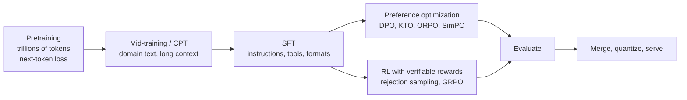

# 1. Foundations and Mathematics of Language Models

**Goal:** understand exactly what a decoder-only language model computes and how it is trained, so that every later method (SFT, DPO, GRPO, ...) is a small modification of something you already understand.
**Labs:** `labs/00_attention_rope_gqa` (attention, RoPE, GQA, RMSNorm, SwiGLU), `labs/02_pretrain_tiny_gpt` (a real training loop).

**How to read the math.** Every important formula is followed by an **In words** line and usually a **worked example with numbers**. If your Markdown viewer does not render `$...$` formulas, the plain-English lines and numeric examples still carry the content; the formulas render in VS Code's built-in preview and in the notebooks.

---

## 1.1 The big picture: where each method fits



| Stage | What the model learns | Who does it | Typical cost |
| --- | --- | --- | --- |
| Pretraining | grammar, facts, code, reasoning patterns, from raw text | the lab that releases the base model | 10^5 - 10^7 GPU-hours |
| SFT | "when asked X, respond like Y" (format, tone, tool syntax) | you | minutes - hours on one GPU |
| Preference / RL | "prefer this kind of answer", "be reliably correct" | you | hours - days on one GPU |

You will almost never run the first row. You start from a public **base** model (pretrained only) or **instruct** model (already post-trained) and run the later rows. Understanding the first row tells you what the model already knows and what post-training can and cannot add: **post-training mostly elicits and shapes abilities the base model already has; it adds little new knowledge.**

---

## 1.2 Tokens: what the model actually reads

A model never sees characters or words; it sees integers called **token ids**.

### Byte-pair encoding (BPE), step by step

1. Start with a vocabulary of single bytes/characters.
2. Count every adjacent pair in a large text corpus; merge the most frequent pair into a new token.
3. Repeat until the vocabulary has $V$ entries (typically 32k-256k).

Worked mini-example on the corpus `low low low lower lowest`:

| Step | Most frequent pair | New token | Text becomes |
| --- | --- | --- | --- |
| 0 | - | - | `l o w _ l o w _ l o w _ l o w e r _ l o w e s t` |
| 1 | `l`+`o` (5x) | `lo` | `lo w _ lo w _ lo w _ lo w e r _ lo w e s t` |
| 2 | `lo`+`w` (5x) | `low` | `low _ low _ low _ low e r _ low e s t` |

Frequent strings become single tokens; rare strings stay split into pieces. Consequences you will feel:

* A token is **not** a word: "unbelievable" may be 3 tokens; numbers split into digit groups; **code and non-English text usually need more tokens per character** (so they cost more memory and time).
* Token count drives **cost**: memory for activations and the KV cache scales with tokens, not characters. Always measure length in tokens.
* Always use the tokenizer that matches the model. A different tokenizer produces different ids and garbage.

### Embeddings and why small models are "embedding-heavy"

The first layer is a lookup table with one learned vector per token: $V\times d$ numbers ($V$ = vocabulary size, $d$ = model width). The last layer maps the final vector back to $V$ scores (logits); many models **tie** (reuse) the same table for both ends.

Worked example: $V=150{,}000$ and $d=1024$ gives $150{,}000\times1024\approx154$ million parameters. In a 0.6B-parameter model that is about a quarter of all weights, spent just on the vocabulary. Practical consequence: LoRA on embeddings is rarely worth it, and for tiny models a smaller vocabulary frees parameters for the layers that do the thinking.

### Special tokens and chat templates

Chat models use special tokens such as `<|im_start|>`, `<|im_end|>`, BOS/EOS and tool-call markers to delimit turns. A **chat template** (a small Jinja program stored with the tokenizer) converts a list of messages into the exact token string the model was trained on, for example:

```text
<|im_start|>system
You are concise.<|im_end|>
<|im_start|>user
2+2?<|im_end|>
<|im_start|>assistant
4<|im_end|>
```

Training with one template and running inference with another is a classic **silent bug**: the model still produces text, but quality drops and it may never emit the stop token (chapter 3).

---

## 1.3 The language-modelling objective

### The idea in one sentence
Given the text so far, predict the next token; learn by being penalised when the real next token was given low probability.

### Step by step

1. The model reads tokens $x_1,\dots,x_{t-1}$ and outputs a probability for every vocabulary entry for position $t$.
2. We look up the probability it gave to the **actual** token $x_t$.
3. The loss is $-\log$ of that probability (so probability 1 costs 0, probability 0.01 costs 4.6).
4. Average over all positions and sequences, and update the weights by gradient descent.

The chain rule factorises the probability of a whole sequence into these steps:

$$
p_\theta(x_{1:T})=\prod_{t=1}^{T}p_\theta(x_t\mid x_{<t})
$$

and training minimises the average **negative log-likelihood** (cross-entropy):

$$
\mathcal{L}(\theta)=-\frac{1}{T}\sum_{t=1}^{T}\log p_\theta(x_t\mid x_{<t})
$$

**In words:** the loss is the average "surprise" of the model at the true next tokens. Lower is better.

### Worked example

Suppose after the prefix `The capital of France is` the model gives: `Paris` 0.80, `Lyon` 0.10, `a` 0.05, everything else 0.05 in total, and the true next token is `Paris`.

* Loss at this position: $-\ln 0.80 = 0.223$ nats.
* If the model had given `Paris` only 0.20, the loss would be $-\ln0.20=1.609$ nats - seven times larger.

### Units and perplexity

* **nats** = loss with natural log (bits if $\log_2$; bits $=$ nats $/\ln2$).
* **Perplexity** $=e^{\mathcal{L}}$: the effective number of equally-likely choices the model is torn between per token. Loss 0.223 is perplexity 1.25 (nearly sure); loss 4.6 is perplexity 100.
* Loss values are comparable only across models with the **same tokenizer and data**. To compare different tokenizers use **bits per byte**: $\text{bpb}=\mathcal{L}\cdot\dfrac{\#\text{tokens}}{\#\text{bytes}\cdot\ln 2}$.

### Loss is not behaviour

A low held-out loss means the model is a good *statistical model of the data*. It does **not** mean it answers correctly when sampled. Lab 02 trains a model on a corpus where half the stated arithmetic answers are wrong: its loss on correct answers is excellent (it knows arithmetic) yet a sampled answer is right only about half the time (it also learned to imitate the wrong ones). This gap is exactly what SFT, preference optimization and RL close.

---

## 1.4 The transformer block, piece by piece

**Notation:** $d$ model width, $h$ number of query heads, $g$ number of key/value heads, $d_h=d/h$ head width, $L$ layers, $s$ sequence length.

A decoder-only model is: embeddings $\to$ $L$ identical blocks $\to$ final norm $\to$ output projection to $V$ logits. Each block does two things: **mix information across positions (attention)** and **transform each position independently (MLP)**, with a residual connection around each.

### 1.4.1 Attention

For each token we compute three vectors from its hidden state $x$: a **query** ($q$: "what am I looking for?"), a **key** ($k$: "what do I contain?") and a **value** ($v$: "what do I contribute if selected?"). With $Q=XW_Q,\ K=XW_K,\ V=XW_V$:

$$
\mathrm{Attn}(Q,K,V)=\mathrm{softmax}\!\left(\frac{QK^\top}{\sqrt{d_h}}+M\right)V
$$

**In words:** each token scores every earlier token by the dot product of its query with their keys, turns the scores into weights that sum to 1 (softmax), and takes the weighted average of their values.

**Step-by-step with a tiny example** (one head, 3 tokens, $d_h=2$). Let the query of token 3 be $q=(1,0)$ and the keys of tokens 1-3 be $k_1=(1,0),\ k_2=(0,1),\ k_3=(1,1)$.

1. Raw scores $q\cdot k_j$: $1,\ 0,\ 1$.
2. Scale by $1/\sqrt{2}=0.707$: $0.707,\ 0,\ 0.707$.
3. Softmax: $e^{0.707}=2.03$, $e^0=1$, $e^{0.707}=2.03$; sum $5.06$; weights $0.40,\ 0.20,\ 0.40$.
4. Output $=0.40\,v_1+0.20\,v_2+0.40\,v_3$.

**Causal mask.** $M_{ij}=-\infty$ for $j>i$, so $e^{-\infty}=0$: token $i$ cannot see later tokens. Without it, a language model would "cheat" by reading the answer during training.

**Why divide by $\sqrt{d_h}$?** If $q$ and $k$ have independent unit-variance entries, $q\cdot k$ is a sum of $d_h$ products each with variance 1, so it has variance $d_h$ (standard deviation $\sqrt{d_h}$). For $d_h=128$ raw scores have standard deviation about 11, making the softmax nearly one-hot (one weight $\approx1$, the rest $\approx0$) and its gradients vanish. Dividing by $\sqrt{d_h}$ restores unit variance. Lab 00 section 2 measures this.

**Multi-head.** $h$ heads run in parallel with their own $W_Q,W_K,W_V$; their outputs are concatenated and mixed by $W_O$. Different heads learn different relations (previous token, matching brackets, subject-verb, ...).

**Cost.** Scores form an $s\times s$ matrix, so compute and (without fused kernels) memory grow **quadratically** in sequence length. FlashAttention-style kernels avoid storing that matrix and are used by default in modern frameworks (`scaled_dot_product_attention`).

### 1.4.2 Position information: RoPE

Attention by itself ignores order (it is a weighted average of a set). **Rotary position embedding (RoPE)** injects position by rotating each pair of channels $(q_{2i},q_{2i+1})$ and $(k_{2i},k_{2i+1})$ by an angle that depends on the token position $m$:

$$
\text{angle}_i(m)=m\,\theta_i,\qquad \theta_i=B^{-2i/d_h}
$$

with base $B$ (commonly 10,000; larger for long context).

**In words:** low-index channel pairs rotate fast (they resolve nearby positions), high-index pairs rotate slowly (they track long distances) - like the hour, minute and second hands of a clock.

**Key property.** Rotations compose: rotating the query by $m\theta$ and the key by $n\theta$ gives a dot product that depends only on $m-n$. So attention depends on **relative distance** without any learned position table. Lab 00 section 3 shows that scores for offset 3 are identical at positions (5,2) and (9,6).

**Long context.** To go beyond the trained length you can raise $B$ or interpolate positions (so the rotation angles stay in the range seen in training). This is why models advertise "RoPE scaling" for 32k-128k contexts; quality still needs evaluation at the target length.

### 1.4.3 Grouped-query attention (GQA) and the KV cache

During generation the model reuses the keys and values of all previous tokens; storing them is the **KV cache**:

$$
\text{KV bytes}=2\cdot L\cdot g\cdot d_h\cdot s\cdot b\cdot \text{bytes per element}
$$

($2$ for keys and values, $b$ = number of concurrent sequences).

**Worked example.** $L=28$ layers, head width $d_h=128$, sequence $s=8192$, batch $b=1$, bf16 (2 bytes):

* Multi-head attention with $g=16$ KV heads: $2\cdot28\cdot16\cdot128\cdot8192\cdot2$ bytes $\approx$ **1.75 GiB**.
* GQA with $g=8$ KV heads: **0.88 GiB**.

GQA shares each K/V head among $h/g$ query heads, cutting the cache (and the K/V weights) by that factor with a small quality cost. **On a 12 GB GPU the KV cache is often the real limit**, and in RL it is multiplied by the number of samples generated at once (chapter 7).

### 1.4.4 Normalisation, MLP and residuals

* **RMSNorm:** $y=\dfrac{x}{\sqrt{\tfrac1d\sum_i x_i^2+\epsilon}}\odot\gamma$. *In words:* rescale the vector to unit root-mean-square, then apply a learned per-channel gain. (LayerNorm additionally subtracts the mean and adds a bias; dropping them is cheaper and works as well.)
* **SwiGLU MLP:** $y=W_d\big(\mathrm{SiLU}(W_gx)\odot W_ux\big)$. *In words:* two parallel projections to a wider space; one acts as a smooth gate on the other; then project back down. Because it uses three matrices, the hidden width is $d_{ff}\approx\tfrac83d$ so the parameter count matches a classic 4x two-matrix MLP.
* **Pre-norm residual stream:**

$$
x\leftarrow x+\mathrm{Attn}(\mathrm{Norm}(x)),\qquad x\leftarrow x+\mathrm{MLP}(\mathrm{Norm}(x))
$$

*In words:* each sublayer adds a correction to a running "residual stream"; the identity path keeps gradients flowing through dozens of layers.

### 1.4.5 Mixture of experts (MoE)

Replace the single MLP by $E$ expert MLPs and a small **router** that sends each token to its $\text{top-}k$ experts. **Total** parameters grow about $E$-fold while **active** parameters per token grow only $k$-fold. Memory must hold *all* experts, so MoE models are usually a poor fit for 12 GB unless heavily quantised, and applying LoRA to experts is more involved.

### 1.4.6 Counting parameters and compute

For a dense model with GQA, SwiGLU and tied embeddings:

$$
N\approx Vd+L\Big[\underbrace{d(hd_h)+2d(gd_h)+(hd_h)d}_{\text{attention: }W_Q,\,W_K,W_V,\,W_O}+\underbrace{3\,d\,d_{ff}}_{\text{MLP}}\Big]
$$

**Worked example** (a ~1.7B-class config): $V=151{,}936,\ d=2048,\ L=28,\ h=16,\ g=8,\ d_h=128,\ d_{ff}=6144$.

* Embeddings: $151{,}936\cdot2048\approx311\text{M}$.
* Attention per layer: $2048\cdot2048+2\cdot2048\cdot1024+2048\cdot2048\approx12.6\text{M}$.
* MLP per layer: $3\cdot2048\cdot6144\approx37.7\text{M}$.
* Per layer $\approx50.3\text{M}$; $\times28=1.41\text{B}$.
* Total $\approx1.72\text{B}$. Lab 01 computes this for any config.

**Compute.** Forward pass $\approx2N$ FLOPs per token (each parameter does one multiply and one add), plus an attention term that grows with $s$. Backward is about twice the forward, so **training $\approx6N$ FLOPs per token** and total training compute $\approx6ND$ for $D$ tokens. Example: full training of a 1.7B model on 10M tokens is $6\cdot1.7\text{e}9\cdot10^7\approx10^{17}$ FLOPs: about 11 hours at a sustained 2.5 TFLOPS, or about an hour at a sustained 30 TFLOPS. This is why hardware throughput and utilisation (MFU) matter (chapter 2).

---

## 1.5 Optimisation: how the weights are updated

### 1.5.1 Gradient descent, then Adam

Plain gradient descent moves each weight against its gradient: $\theta\leftarrow\theta-\eta g$. Deep nets train poorly with one global step size because different weights have very different gradient scales. **Adam** tracks, for each weight, a running average of the gradient ($m$, the direction) and of its square ($v$, the scale), and divides one by the other:

$$
m_t=\beta_1m_{t-1}+(1-\beta_1)g_t,\qquad v_t=\beta_2v_{t-1}+(1-\beta_2)g_t^2
$$

$$
\theta_t=\theta_{t-1}-\eta\Big(\frac{\hat m_t}{\sqrt{\hat v_t}+\epsilon}+\lambda\,\theta_{t-1}\Big)
$$

where $\hat m,\hat v$ are bias-corrected ($m/(1-\beta_1^t)$, $v/(1-\beta_2^t)$) and $\lambda$ is **decoupled weight decay** (AdamW; Loshchilov & Hutter, 2019).

**In words:** every weight takes a step of roughly size $\eta$ in the direction its gradient has consistently pointed, regardless of how large or small its raw gradient is; weight decay gently shrinks weights toward zero.

Typical LLM settings: $\beta_1=0.9$, $\beta_2=0.95$ to $0.999$, $\epsilon=10^{-8}$, $\lambda=0$ to $0.1$.

### 1.5.2 Why Adam makes full fine-tuning expensive (the 16-byte rule)

Per parameter in standard mixed-precision training:

| Item | Bytes |
| --- | --- |
| weight (bf16) | 2 |
| gradient (bf16) | 2 |
| fp32 master copy of the weight | 4 |
| Adam first moment $m$ (fp32) | 4 |
| Adam second moment $v$ (fp32) | 4 |
| **Total** | **16** |

So a 1.7B model needs about $1.7\text{e}9\times16\approx27$ GB **before activations** - far above 12 GB. LoRA trains only small adapters, so only adapter parameters pay the optimizer cost while the frozen base costs 2 bytes per parameter (chapter 4).

### 1.5.3 Learning-rate schedule

* **Warmup:** raise the learning rate linearly from ~0 over the first 1-5% of steps; early updates are noisy because Adam's estimates are not yet reliable.
* **Decay:** cosine or linear decay to ~10% of the peak; large steps help early, small steps refine later.
* Learning rate is the most important hyperparameter. Too high: the loss spikes or diverges; too low: training is slow and under-fits. Chapter 4 gives the LoRA-specific rule (about 10x the full fine-tuning rate).

### 1.5.4 Other training mechanics

* **Gradient clipping** (global norm 1.0): rescale the gradient if its norm exceeds 1, protecting against occasional huge-gradient steps.
* **Effective batch size** $=\text{micro-batch}\times\text{gradient accumulation steps}\times\#\text{devices}$. Accumulation runs several small batches and sums gradients before one optimizer step: same update as one big batch, but peak activation memory of the small one (it costs wall-clock time, and when sequences are padded the per-token weighting can differ slightly).
* **Mixed precision:** do the matrix multiplies in **bf16** (same exponent range as fp32, fewer mantissa bits, so no loss scaling needed) or **fp16** (needs loss scaling because its range is small). Keep optimizer state and master weights in fp32 unless you understand the trade-off. PyTorch XPU supports bf16, fp16 and automatic mixed precision on Arc B-series.
* **Gradient checkpointing:** do not store every activation; recompute them during the backward pass. Roughly +30% time for a large cut in activation memory - usually the right trade on a 12 GB card.

---

## 1.6 Scaling laws: why small models can be good

### The empirical law

Across many experiments the loss follows a power law in parameters $N$ and training tokens $D$ (Kaplan et al., 2020; Hoffmann et al., 2022 "Chinchilla"):

$$
L(N,D)\approx E+\frac{A}{N^{\alpha}}+\frac{B}{D^{\beta}}
$$

**In words:** there is an irreducible loss $E$; adding parameters helps with diminishing returns; adding data helps with diminishing returns; you need both.

### Compute-optimal vs inference-optimal

For a fixed training compute $C\approx6ND$, Chinchilla found the best split is roughly $D\approx20N$ tokens (a 1B model on ~20B tokens). **But deployed small models are trained far beyond that** - trillions of tokens for single-digit-billion-parameter models - because inference cost scales with $N$, not with $D$: spending extra training compute once buys a smaller, cheaper model for every future query.

### What this means for you

* A well-made 1-4B model inherits enormous, curated (and often **distilled from larger teachers**) data exposure; it can be surprisingly capable.
* Capacity limits remain. Studies estimate roughly **2 bits of factual knowledge per parameter**, so a 1B model cannot store as many facts as a 70B one; multi-step planning and long-horizon consistency degrade first; small models are more sensitive to quantisation and prompt format.
* **Post-training is where a small model becomes useful for *your* task.** A narrow behaviour (format, tool use, a domain's conventions) needs far fewer bits than world knowledge, so adapter-sized updates suffice (chapter 4). For facts, retrieve them instead of memorising (chapter 13).

---

## 1.7 Decoding: turning probabilities into text

The model outputs logits $z$ (one score per vocabulary entry). Sampling uses

$$
p_i=\mathrm{softmax}(z_i/T)=\frac{e^{z_i/T}}{\sum_j e^{z_j/T}}
$$

**In words:** temperature $T<1$ sharpens the distribution (more deterministic), $T>1$ flattens it (more random), $T\to0$ is greedy argmax.

**Worked example.** Logits $z=(2.0,\ 1.0,\ 0.0)$.

| $T$ | probabilities |
| --- | --- |
| 1.0 | 0.665, 0.245, 0.090 |
| 0.5 | 0.867, 0.117, 0.016 |
| 2.0 | 0.506, 0.307, 0.186 |

| Method | Idea | Use |
| --- | --- | --- |
| Greedy | always pick the argmax | deterministic evaluation of format/extraction |
| Temperature | rescale logits | trade diversity vs reliability |
| $\text{Top-}k$ / $\text{top-}p$ (nucleus) | sample only from the $k$ most likely / smallest set with total probability $p$ | avoid improbable tokens |
| $\text{min-}p$ | keep tokens with $p_i\ge p_{\min}\cdot p_{\max}$ | adaptive truncation |
| Beam search | keep the best $b$ prefixes | translation; rarely for chat |

Rules: always **fix and report** decoding settings with any result; evaluate extraction/code with greedy or low temperature; **RL needs $T\approx1$** because it learns from the diversity of the model's own samples (chapter 7).

---

## 1.8 Pros and cons of the architecture choices you will meet

| Choice | Pros | Cons |
| --- | --- | --- |
| Decoder-only | one model for every task; simple training | no bidirectional context; encoders are cheaper for classification/embeddings |
| GQA | much smaller KV cache, faster decoding | small quality loss vs full multi-head |
| RoPE | relative positions; long-context tricks exist | extrapolation beyond trained length needs care |
| RMSNorm | cheaper than LayerNorm | none significant |
| SwiGLU | better quality per parameter | three matrices (wider code paths) |
| MoE | large capacity at fixed active compute | all experts must fit in memory; routing instability; LoRA on experts is awkward |
| Tied embeddings | saves $Vd$ parameters | slightly constrains the output head |

---

## 1.9 Common misconceptions

| Misconception | Reality |
| --- | --- |
| "Lower loss means a better assistant" | loss measures modelling of the data, not behaviour when sampled (lab 02) |
| "More parameters is always better" | a smaller model trained on more/better data can win; data quality and post-training matter |
| "Fine-tuning teaches the model new facts reliably" | it mostly teaches behaviour and format; retrieval is better for facts |
| "Context length is free" | KV cache and attention compute grow with length |
| "A bigger batch is always better" | fine-tuning often works best at modest effective batch sizes; LoRA tolerates huge batches worse than full fine-tuning |

---

## Checkpoint

You are ready to continue when you can:

1. Compute, by hand, the cross-entropy loss of a prediction and explain why sampling a low-loss model can still be wrong (lab 02).
2. Walk through attention for three tokens, including the causal mask and the $\sqrt{d_h}$ scaling.
3. Compute $N$ and the KV cache for a model config from its `config.json` (lab 01).
4. Explain why AdamW needs about 16 bytes per parameter and what LoRA changes.
5. State the Chinchilla rule and why deployed small models violate it on purpose.

## Sources to read

Vaswani et al. 2017 (*Attention Is All You Need*); Su et al. 2021 (*RoFormer*, RoPE); Ainslie et al. 2023 (*GQA*); Zhang & Sennrich 2019 (*Root Mean Square Layer Normalization*); Shazeer 2020 (*GLU Variants Improve Transformer*); Loshchilov & Hutter 2019 (*Decoupled Weight Decay Regularization*, AdamW); Kaplan et al. 2020 (*Scaling Laws for Neural Language Models*); Hoffmann et al. 2022 (*Training Compute-Optimal Large Language Models*). Andrej Karpathy's "Let's build GPT" is the best video companion to lab 02. (Cited by title/authors/year; look them up to confirm details.)
