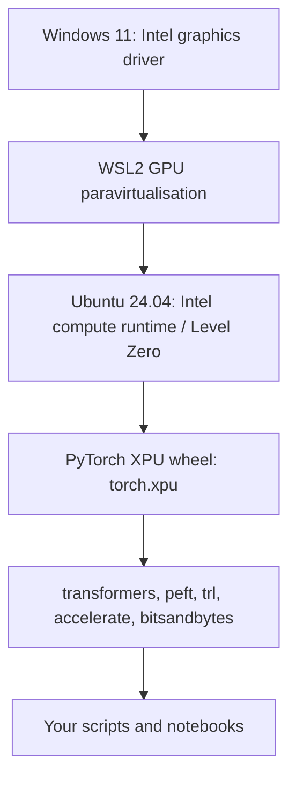

# 2. Hardware, WSL2 and the Intel XPU Software Stack

**Goal:** a reproducible WSL2 Ubuntu 24.04 environment where PyTorch sees your Arc B580, plus the memory arithmetic to decide what you can train.
**Lab/script:** `labs/01_memory_and_flops`, `scripts/00_xpu_check`.

## 2.1 What changed since 2024-25 (and why the old advice is wrong)

| Old advice | Reality (verified 2026-09) |
| --- | --- |
| Install Intel Extension for PyTorch (IPEX) | IPEX **repository archived 2026-03-30**; Intel says most features were upstreamed and recommends using PyTorch directly |
| Intel GPUs are experimental in PyTorch | `torch.xpu` has been in upstream PyTorch since 2.5; docs list **Arc B-series (Battlemage)** as validated on Windows 11, Ubuntu 24.04/26.04 and **WSL2 Ubuntu 24.04/26.04** |
| QLoRA needs NVIDIA | `bitsandbytes` documents an **Intel XPU backend** (PyTorch >= 2.6; Linux and Windows builds) |
| GradScaler always works | GradScaler needs FP64 hardware support, which Arc **A-series** lacks; prefer bf16 without a scaler |

Sources: PyTorch "Getting Started on Intel GPU" (2.14 docs), the Intel "PyTorch Prerequisites for Intel GPUs" page, the IPEX archive notice, and the bitsandbytes installation guide.

## 2.2 Architecture of the stack

The Windows driver is the GPU driver; Ubuntu needs only the user-mode compute libraries. The PyTorch XPU wheels pull in the Intel Deep Learning Essentials runtime packages automatically, so end users should **not** install the full oneAPI toolkit (only people building PyTorch from source need it).

## 2.3 Step-by-step setup

1. **Windows driver.** Install the latest Intel Arc graphics driver. Reboot.
2. **WSL2.** In an elevated PowerShell: `wsl --install -d Ubuntu-24.04`, then `wsl --update` and `wsl -l -v` (VERSION must be 2). Restart WSL with `wsl --shutdown` after updates.
3. **Ubuntu basics.** `sudo apt update && sudo apt upgrade`, `sudo apt install -y build-essential git python3-venv python3-pip`.
4. **GPU user-mode runtime in Ubuntu.** Follow the *"Install for WSL2"* section of Intel's "PyTorch Prerequisites for Intel GPUs" page for your exact PyTorch release. (Package names/repositories change between releases, so copy commands from that page rather than from a blog, including this one.)
5. **Project location.** Work on the Linux filesystem (`~/projects/model-training`), not `/mnt/d/...`: the Windows-mounted drive is slow for many small files and breaks some permission semantics. Copy this course in, and keep datasets, checkpoints and the Hugging Face cache (`~/.cache/huggingface`) in Linux too.
6. **Virtual environment.** `python3 -m venv ~/venvs/llm && source ~/venvs/llm/bin/activate`.
7. **PyTorch XPU.** `pip install torch --index-url https://download.pytorch.org/whl/xpu` (the docs' stable-release command; add `torchvision torchaudio` if needed).
8. **Gate check.** Run `scripts/00_xpu_check.py`: it prints `torch.xpu.is_available()`, device name, memory, bf16 support, measured matmul TFLOPS and bandwidth. **Do not continue until `is_available()` is True.**
9. **Libraries.** `pip install transformers datasets accelerate peft trl` and (for QLoRA) `pip install bitsandbytes`. Use recent versions; TRL's API moves fast (it has recently changed defaults such as GRPO `loss_type` and `beta`).
10. **Notebook support.** `pip install jupyterlab ipykernel` and register the venv as a kernel. VS Code's WSL extension lets you open the Linux folder directly.

### Troubleshooting ladder (in this order)

| Symptom | Likely cause | Fix |
| --- | --- | --- |
| `torch.xpu.is_available()` is False | driver/WSL/runtime mismatch | update Windows driver, `wsl --update`, recheck step 4; try the newest stable torch XPU wheel |
| Import works but training silently slow | CPU fallback | assert `model.device.type == "xpu"`; print `next(model.parameters()).device` |
| Out-of-memory at step 1 | sequence too long / batch too large / logits | halve `max_length`, batch 1 + gradient accumulation, enable checkpointing |
| Out-of-memory after hours | memory fragmentation/leak | log `torch.xpu.max_memory_allocated()`, call `torch.xpu.empty_cache()` between phases, restart process |
| Kernel "not implemented for XPU" | missing op in that version | upgrade torch; fall back for that op; report upstream |
| WSL uses too much RAM | default WSL memory limit | set `memory=` and `swap=` in `%UserProfile%\.wslconfig`, then `wsl --shutdown` |

## 2.4 Memory arithmetic

All quantities in bytes per parameter unless stated. (Lab 01 computes these for real model configs.)

| Mode | Weights | Gradients | Optimizer | Total (typical) |
| --- | --- | --- | --- | --- |
| Full FT, bf16 + fp32 master + Adam | 2 | 2 | 4 (master) + 8 (m, v) | **~16** |
| Full FT, pure bf16 AdamW | 2 | 2 | 4 (m, v in bf16) | ~8 (riskier numerically) |
| LoRA on bf16 base | 2 (frozen) | 0 | 0 | 2 per base parameter + 16 per *adapter* parameter |
| QLoRA (NF4 base) | ~0.5-0.6 | 0 | 0 | ~0.56 per base parameter + 16 per adapter parameter |

Worked examples (weights/optimizer only, **activations excluded**):

| Model | Full FT (16 B/p) | LoRA bf16 (2 B/p) | QLoRA (~0.56 B/p) |
| --- | --- | --- | --- |
| 0.6B | ~9.6 GB | ~1.2 GB | ~0.34 GB |
| 1.7B | ~27 GB (**no**) | ~3.4 GB | ~0.95 GB |
| 4B | ~64 GB (**no**) | ~8 GB | ~2.2 GB |
| 8B | ~128 GB (**no**) | ~16 GB (**no**) | ~4.5 GB |

**Activations** scale as $s\cdot b\cdot d\cdot L$ times a constant ($\approx34$ bytes per $s\,b\,d$ per layer without recomputation for a standard block; much less with checkpointing and fused attention). **Logits** cost $b\cdot s\cdot V$ values in fp32 *plus gradient*: with $V=150\text{k}$, $s=2048$, $b=1$ that is ~1.2 GB for logits alone (2.4 GB with gradient). Recent TRL versions compute the SFT cross-entropy in chunks by default to avoid materialising all logits, which matters a lot on 12 GB.

**RL memory** adds generation: the KV cache of $G\times B$ concurrent completions, often the binding constraint (lab 01 section 3).

**Rule of thumb for 12 GB:** keep total under ~10.5 GB in your estimate to leave room for runtime overhead and fragmentation; if the estimate is tight, reduce `max_length`, then batch, then rank, then model size.

## 2.5 Speed arithmetic

* Training FLOPs $\approx6ND$ (full FT) or roughly $4ND$ for LoRA (no weight-gradient matmuls for frozen layers: $2N^2+6NR$ vs $3N^2$ multiply-adds per matrix in the Thinking Machines analysis, about two-thirds of full FT).
* Decoding is **memory-bandwidth bound**: tokens/s $\lesssim$ bandwidth / bytes of weights read per token. A 4-bit 4B model reads ~2.2 GB per token, so a ~450 GB/s card (check your real number with script 00) gives an upper bound near 200 tokens/s for a single stream; batching raises total throughput because weight reads are shared.
* RL and evaluation spend most time generating, not updating. Plan wall-clock accordingly.

## 2.6 Choosing software

| Need | Tool | Notes |
| --- | --- | --- |
| Training loop with chat templating, masking, packing | `trl.SFTTrainer` | supports PEFT, VLMs, tool-calling data |
| Preference optimisation | `trl.DPOTrainer` (+ experimental ORPO/CPO), `KTOTrainer` | |
| RL with verifiable rewards | `trl.GRPOTrainer`, `RLOOTrainer` | custom reward functions; `environment_factory` for agents |
| Adapters | `peft` | LoRA, QLoRA, DoRA, rsLoRA options |
| Quantised training | `bitsandbytes` (XPU backend) | check the version supports your torch |
| Fast single-GPU recipes | Unsloth, Liger kernels | verify XPU support in current release notes before relying on them |
| Inference/serving | PyTorch `generate`, llama.cpp (SYCL/Vulkan backends), OpenVINO, vLLM | XPU/Battlemage/WSL support varies - verify per tool (chapter 15) |

## 2.7 Model choice for 12 GB

Choose by evidence on **your** task. A reasonable progression:

1. Smoke-test pipelines with a 0.5-0.6B model (minutes per run).
2. Move to 1.5-2B for real experiments.
3. Try 3-4B when your metric plateaus and memory allows (LoRA/QLoRA, short context).
4. Use an 7-8B model only as a *teacher/judge* (4-bit inference) or with QLoRA on short sequences.

Check for each candidate: license (commercial use?), chat template + tool-call format, tokenizer efficiency for your language/code, context length, whether it is a base or instruct variant, and a VLM variant if you need images.

## Checkpoint

* `scripts/00_xpu_check.py` passes and you have recorded measured TFLOPS, bandwidth and usable GiB.
* You can estimate whether a (model, method, sequence length, batch) fits before launching it.
* Your environment is pinned (`pip freeze > requirements.lock`) and its versions are noted in your experiment log.
