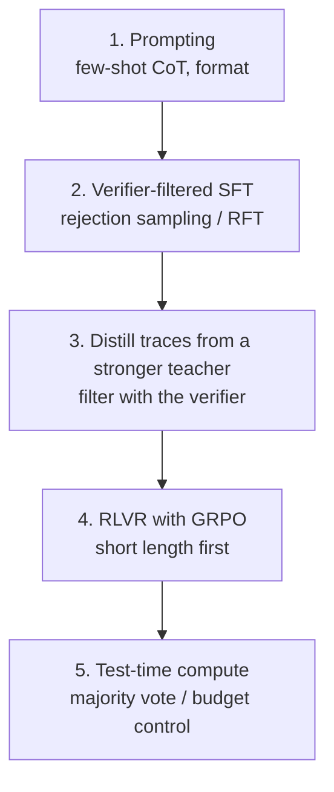

# 8. Reasoning Models

**Goal:** train a small model that solves multi-step problems more reliably, using the methods in order of cost: prompting, verifier-filtered SFT, distillation, RL with verifiable rewards.
**Lab:** `labs/05_rejection_sampling_and_passk` (plus chapters 5 and 7).

## 8.1 What "reasoning" means operationally

A reasoning model writes **intermediate tokens** (a chain of thought, CoT) before the final answer, using extra *test-time compute* to improve accuracy on problems with multi-step structure: math, logic, planning, code, tool plans. The key to training it is a **verifier**: something that decides whether the final outcome is right.

Two caveats to keep in mind throughout:
* A fluent rationale is not evidence of correct reasoning. Judge by verified outcomes.
* Longer is not better. Small models readily learn to *sound* like reasoning (verbosity) without gaining accuracy.

## 8.2 Mathematical tools

**pass@k.** With $n$ samples of which $c$ are correct, the unbiased estimator is
$$\text{pass@}k=1-\binom{n-c}{k}\Big/\binom{n}{k}$$
(Chen et al., 2021). If samples were independent with per-sample success $p$: pass@$k=1-(1-p)^k$. The gap between pass@1 and pass@$k$ is your **headroom** for rejection sampling and RL.

**Majority vote (self-consistency)** (Wang et al. 2022): sample $N$ chains, take the most frequent final answer. If the correct answer has probability $p_c$ and each wrong answer less, majority voting accuracy $\to1$ as $N$ grows. Improves accuracy without training; costs $N\times$ inference.

**Best-of-$N$ with a verifier/reward model:** expected best score grows roughly like $\sqrt{2\ln N}$ for Gaussian scores, i.e. slowly; with an *imperfect* proxy reward, the true reward can peak and then decline with $N$ (lab 11 section 2).

**Test-time compute scaling.** Snell et al. (2024) show that for many problems, spending inference compute (more samples, verifier-guided search) can be more efficient than scaling parameters - *if* the base model has a reasonable success rate on the problem. This is why small reasoning models can rival larger non-reasoning ones on some benchmarks, at the cost of many more generated tokens.

## 8.3 The ladder of methods

**1. Prompting baseline.** Few-shot or "think step by step" with a strict answer format. Measure pass@1 and average tokens. If this already meets your target, stop.

**2. Rejection-sampling fine-tuning (STaR / RFT).** Sample $k$ solutions, keep verified ones, SFT on them, repeat (*expert iteration*). STaR (Zelikman et al. 2022) adds **rationalisation**: for failures, give the correct answer as a hint and ask for a rationale that reaches it, then keep it if verified. Lab 05 runs it end-to-end on a toy verifier.

**3. Distillation of reasoning traces.** Section 5.4. Often the highest return for small models. Filter by correctness, length and format. The s1 paper (Muennighoff et al. 2025) reports strong results from SFT on ~1,000 *carefully curated* long-CoT examples plus **budget forcing** (controlling thinking length at inference by truncating or appending "Wait"), again illustrating curation over volume (cited by title/authors/year; verify claims in the paper).

**4. RL with verifiable rewards (RLVR).** Chapter 7. The DeepSeek-R1 report describes:
* **R1-Zero:** RL applied directly to a base model with accuracy and format rewards; reasoning length and self-verification behaviours emerged, but outputs were poorly readable/mixed languages.
* **R1:** a multi-stage pipeline: small *cold-start* SFT on long CoT -> reasoning-oriented RL (plus a language-consistency reward) -> rejection sampling to create SFT data (reasoning + general) -> a final RL stage for helpfulness/harmlessness.
* **Distilled small models:** SFT of small dense models on R1-generated traces, which the report found better than RL directly on those small models.
Open reproductions exist (Hugging Face *Open-R1*). The lesson for you: **cold-start SFT then RL**, not RL alone, is the safer path on small models.

**5. Test-time compute.** Majority vote, verifier-ranked best-of-$N$, limited thinking budgets; hybrid models that can switch thinking on/off. Always report tokens per answer alongside accuracy.

## 8.4 A concrete small-model recipe (12 GB)

1. **Pick a verifiable domain close to your goal**: arithmetic/word problems, SQL over a known schema, unit-tested code, constraint-following instructions, logic puzzles, tool-use traces.
2. **Write the verifier first** (and test it with positive/negative/adversarial cases). Parse the final answer from a fixed marker (`\boxed{}` or `<answer>`).
3. **Split** prompts: train / dev / test, by problem template and difficulty.
4. **Baseline**: model x prompt format -> pass@1 (n=8 samples), pass@8, mean tokens.
5. **Stage A (SFT cold start):** 1-5k verified examples (from rejection sampling or a teacher), LoRA, 1-3 epochs. Re-measure.
6. **Stage B (RLVR):** GRPO with LoRA, `num_generations` 8, `max_completion_length` 256-512, `beta=0`, LR ~1e-5. Mask truncated completions. Correctness reward 1.0 + format 0.1.
7. **Curriculum:** filter prompts to those with base pass rate in (0.1, 0.9); mix in some easy ones for stability; drop prompts with zero-variance groups.
8. **Stage C (optional):** rejection-sample the RL model and SFT again to consolidate and shorten; evaluate.
9. **Evaluate:** pass@1 over $n\ge8$ samples on the *held-out* test set with CIs; length distribution; failure categories; general-ability regression.
10. **Serve** with the decoding settings you evaluated.

## 8.5 Reward and format design

* Format: `<think>...</think><answer>...</answer>` or a boxed answer. Reward the format lightly and **parse robustly** (strip whitespace, handle units/fractions, normalise numbers, use symbolic equality where possible).
* Answers must be **checkable**: multiple-choice guessing has a 25% floor and is easy to hack; prefer free-form numeric/structured answers.
* Avoid rewarding reasoning *length*; if you must control it, penalise only *excess* beyond a budget after accuracy is high.
* Double-check the verifier on model outputs that look wrong-but-rewarded and right-but-penalised.

## 8.6 Evaluation pitfalls (specific to reasoning)

| Pitfall | Why | Remedy |
| --- | --- | --- |
| Tiny benchmarks (e.g. ~30-problem sets) | huge variance | average many samples; report CIs; add more problems (lab 08) |
| Contamination | public benchmarks appear in pretraining/teacher data | private problems; programmatic generators; n-gram checks |
| Different decoding per model | unfair | fix temperature, top-p, max tokens, number of samples |
| Truncation counted as wrong (or hidden) | changes ranking | report % truncated; same max length |
| Comparing pass@k to pass@1 | apples vs oranges | state $k$; use unbiased estimator |
| Verbosity inflation | cost, latency | report mean tokens and accuracy vs tokens |

## 8.7 Pros and cons

| Approach | Pros | Cons |
| --- | --- | --- |
| Prompting + majority vote | no training | costly inference; limited by base ability |
| Verifier-filtered SFT | stable, cheap, easy | saturates at base pass@$k$; imitation only |
| Teacher distillation | strongest early gains | license/contamination; style and length transfer; needs teacher |
| RLVR (GRPO) | optimises the real goal; robust behaviours | needs verifier and non-zero pass rate; sampling cost; hacking |
| Process supervision | dense credit assignment | labels are expensive; gameable |

## Checkpoint

* You have a tested verifier and a baseline table (pass@1, pass@8, tokens).
* You can explain STaR/RFT, R1-Zero vs R1, and why cold-start SFT then RL is preferred for small models.
* Your plan reports pass@1 with CIs, token cost, and failure categories.
