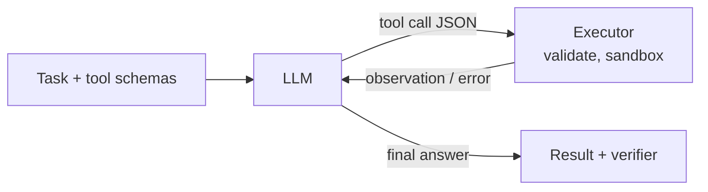

# 9. Agents and Tool Use

**Goal:** turn a small LM into a reliable *tool-using agent*: define tools, train the call format, evaluate in closed loop, and keep it safe.
**Lab:** `labs/09_agent_environment_and_compounding_error`. Builds on chapters 4, 7, 8.

## 9.1 What an agent is

An **agent** is a loop around a policy $\pi_\theta$:



State = conversation history (task, calls, observations). Action = either a **tool call** or a **final answer**. Reward usually arrives at the end (did the task succeed?). Everything in chapter 7 applies, with two additions: *multi-turn* structure and *untrusted observations*.

## 9.2 Function-calling format

Tools are described with JSON schema (name, description, typed parameters). The model emits a structured call; the executor runs it and appends a `tool` message:

```json
{"role":"assistant","tool_calls":[{"type":"function","function":{"name":"run_sql","arguments":{"query":"SELECT COUNT(*) FROM orders"}}}]}
{"role":"tool","name":"run_sql","content":"[[42]]"}
{"role":"assistant","content":"There are 42 orders."}
```

* Different model families use different tool-call syntaxes inside their chat templates. Use the template's own tool rendering; do not hand-roll it.
* **ReAct** (Yao et al. 2022; arXiv 2210.03629) interleaves *Thought -> Action -> Observation*; it is the ancestor of most agent prompts. **Toolformer** (Schick et al. 2023) trained models to insert API calls by self-supervision.
* Hugging Face `trl` SFT accepts tool-calling data (`tool_calls`, `tool` role messages and a `tools` column of JSON schemas); GRPO accepts `tools=[python functions]` (type-hinted with Google-style docstrings) or `environment_factory` for stateful environments.

## 9.3 Designing tools for small models

| Principle | Why it matters to a 1-4B model |
| --- | --- |
| **Few tools** (<=10 in the prompt; retrieve the rest) | long schemas eat context and confuse selection |
| **Verb-noun names, flat parameters** | fewer nesting errors |
| **Strict types and enums** | lets you validate and use constrained decoding |
| **Idempotent, reversible actions; dry-run modes** | recovery from mistakes |
| **Informative errors** ("column `nme` not found; did you mean `name`?") | error text is training signal for recovery |
| **Coarse "macro" tools** for frequent sequences | reduces horizon $T$ (compounding error) |
| **Deterministic, fast, sandboxed** | rollouts are expensive; nondeterminism breaks rewards |

## 9.4 Training recipe

### Stage A - SFT on trajectories
1. Define tools and a **simulated or real sandbox environment** with `reset()` and a success checker.
2. Generate trajectories: a scripted expert (programmatic tasks), a stronger model acting in the environment (filter by success), or humans. Include **recoveries** (mistake -> error message -> fix) and **clarifying questions / refusals** where appropriate.
3. Format as multi-turn chat with tool messages. **Mask the loss on tool outputs and user/system text**: train only on assistant turns (calls and final answers). Otherwise the model learns to hallucinate observations.
4. LoRA SFT (chapter 4). Evaluate closed-loop.

### Stage B - Rejection sampling in the environment
Sample $k$ full episodes per task from the SFT model, keep successful ones (optionally the shortest), fine-tune again (lab 05 logic, with an environment as verifier).

### Stage C - RL
GRPO with an environment: reward = task success (+ small penalties for invalid calls, repeated calls, policy violations, excess steps). In TRL, `environment_factory` builds one environment per rollout whose public methods become tools, with `reset()` returning the task prompt and optional `get_reward()`; `max_tool_calling_iterations` caps turns. It requires a *prefix-preserving* chat template (TRL patches several families) and a recent `transformers`. TRL also lists integrations with OpenEnv, OpenReward and Harbor task suites. Memory grows with multi-turn length: keep episodes short (<= ~5 tool calls) on 12 GB.

## 9.5 The mathematics of long horizons

If each step is correct with probability $p$ and any error is unrecoverable, success of a $T$-step task is $p^T$ (lab 09: $0.95^{10}=0.60$, $0.95^{30}=0.21$). With **recovery** probability $\rho$ after an error, the chain behaves like a Markov process; even modest $\rho$ changes outcomes dramatically. Consequences:

* **Step accuracy is the wrong metric**; measure closed-loop success.
* Shorten horizons (macro tools, better observations, retrieval of relevant state).
* Train on *recovery* trajectories; evaluate with injected perturbations.
* Add verifiers after steps that can be checked cheaply (schema validation, unit tests, dry runs).

**Cost model:** expected tokens per task $\approx\sum_t(\text{prompt}_t+\text{gen}_t)$ and prompts grow each turn; budget context with summarisation or state-compacting tools.

## 9.6 Constrained decoding

For structured calls you can force valid output: restrict the next-token distribution to tokens allowed by a JSON-schema/grammar automaton. Pros: removes syntax errors entirely, lets a smaller model succeed. Cons: may distort probabilities (forced tokens after a mistake), needs tokenizer-aware implementation, can reduce quality if the schema is too tight. Use it at inference; also generate training data with it.

## 9.7 Security model (non-negotiable)

1. **Least privilege:** each tool gets only the permissions it needs; read-only by default.
2. **Sandboxing:** containers/VMs, no network unless allow-listed, resource limits, ephemeral filesystems. A subprocess timeout is *not* a sandbox.
3. **Validation before execution:** schema, allow-lists, argument bounds, rate limits.
4. **Confirmation gates** for irreversible or external actions (send, pay, delete, deploy, share data).
5. **Untrusted observations:** web pages, emails, tool outputs may contain **prompt injection** ("ignore previous instructions..."). Treat observation text as *data*. Keep the instruction channel separate, never let observation text change permissions, and test with injection suites (lab 09 section 4).
6. **Secrets:** never in prompts or logs; use scoped, short-lived credentials outside the model's reach.
7. **Audit logging** and a kill switch.
8. **Reward safety:** penalise violations heavily in RL; never reward actions you could not safely allow in production.

## 9.8 Evaluation

| Metric | Definition |
| --- | --- |
| Task success (closed loop) | verifier passes at episode end |
| Tool-selection accuracy | correct tool chosen when a call is needed |
| Argument accuracy | exact/AST match or semantic check |
| Invalid-call rate | schema/tool errors per episode |
| Redundant/loop rate | repeated identical calls |
| Steps and tokens per success | efficiency |
| Recovery rate | success after an injected failure |
| Safety | violations attempted, injection success rate |
| Abstention quality | correct refusals / clarifying questions |

Public benchmarks exist for function calling (e.g. Berkeley Function-Calling Leaderboard), multi-turn tool use with policies (tau-bench), web tasks (WebArena), software engineering (SWE-bench), and general agents (AgentBench); names and versions change, so **read the current benchmark pages**, check contamination, and always keep a private task set that mirrors your use case.

## 9.9 Step-by-step project: read-only SQL analyst

1. Build a small SQLite database and 200 question/answer pairs generated from templates (joins, aggregates, filters).
2. Tools: `list_tables()`, `describe(table)`, `run_sql(query)` (read-only: open the DB in read-only mode, reject non-SELECT, limit rows and time).
3. Verifier: compare returned value(s) to gold (normalise order, rounding).
4. Baseline: prompted model. Measure success, calls per task, invalid SQL rate.
5. SFT on scripted-expert trajectories (including error -> fix examples).
6. Rejection sampling; then GRPO with `environment_factory` if needed.
7. Evaluate on held-out *schemas* (not only held-out questions).
8. Red-team: injection strings in table contents, `DROP TABLE` requests, huge result sets.

## 9.10 Pros and cons

| Approach | Pros | Cons |
| --- | --- | --- |
| Prompt-only agent | zero training | unreliable formats; long prompts |
| SFT on trajectories | stable; teaches formats/recovery | only as good as demos; weak on unseen states |
| + rejection sampling | closed-loop data | needs environment + verifier |
| + RL | robust closed-loop success | expensive; hacking; safety needs care |
| Constrained decoding | zero syntax errors | semantic errors remain; implementation complexity |

## Checkpoint

* You can explain why step accuracy overstates agent success and compute $p^T$.
* You have a sandbox with validation, confirmation gates and an injection test.
* Your trajectories mask tool outputs from the loss and include recoveries.
