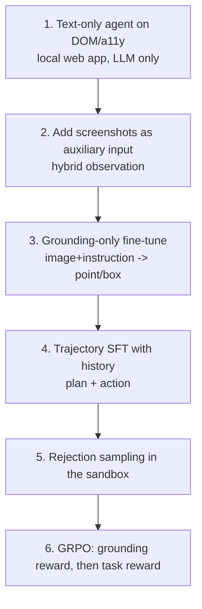

# 10. Computer-Use (GUI) Agents: Vision-Language-Action for Desktop, Mobile and Web

**Goal:** understand and build small agents that look at a screen (or its accessibility tree) and act with clicks, typing and gestures - for software, **not robotics**.
**Lab:** `labs/09_agent_environment_and_compounding_error`. Builds on chapters 4, 7, 9.

> Several model names, datasets and benchmarks below are cited from my knowledge of the literature up to 2025 and could not be re-verified through the paper index while writing. Names are given so you can look them up; confirm current numbers and licenses yourself.

## 10.1 The problem

A GUI agent receives a **goal** ("turn on dark mode and set the font size to 14") and repeatedly:
1. **Observes** the screen state,
2. **Decides** the next action,
3. **Acts** through an input interface,
until done. It needs two distinct skills:

| Skill | Question | Example metric |
| --- | --- | --- |
| **Grounding** | *Where* on the screen is the element called "Dark mode"? | click lands inside the target box (ScreenSpot-style accuracy) |
| **Planning / navigation** | *Which* element should I act on next, given the goal and history? | step success, task success |

Separating them is useful: a grounding model can be trained and evaluated independently and is far cheaper to verify (the answer is a box).

## 10.2 Observation interfaces

| Interface | Content | Pros | Cons |
| --- | --- | --- | --- |
| **DOM / accessibility tree** (web, Windows UIA, Android view hierarchy, Linux AT-SPI) | structured elements with ids, roles, labels, states | compact text; exact targets; works with text-only LLMs; cheap | missing/wrong for canvases, games, custom widgets; can be huge |
| **Screenshot** | pixels | universal; what humans see | many tokens; needs a VLM; grounding is hard; resolution sensitive |
| **Set-of-marks (SoM)** | screenshot with numbered boxes overlaid (from a11y tree or detector) | turns grounding into choosing a number | needs a detector/tree; marks may occlude content |
| **Hybrid** (screenshot + a11y text) | both | most robust | longest context |

**Image-token budget.** For Qwen2-VL/Qwen2.5-VL-style processors one visual token covers about $28\times28$ pixels, so tokens $\approx\frac{H\cdot W}{28^2}$: a $1280\times720$ screenshot is ~1,200 tokens; a $1920\times1080$ one ~2,600. Keep several previous screenshots and you fill the context *and* the activation memory. Always control `min_pixels/max_pixels` (check your model's processor) and keep only the last 1-3 screenshots plus text history of earlier actions.

## 10.3 Action spaces

Keep the action space **small, typed and validated**. Typical set:

```json
{"action":"click","x":0.42,"y":0.17}          // normalized [0,1] or [0,1000] coordinates
{"action":"click","element_id":"sw_dark"}      // when an a11y id is available (preferred)
{"action":"type","text":"14","element_id":"tb_font"}
{"action":"scroll","direction":"down","amount":0.5}
{"action":"swipe","from":[0.5,0.8],"to":[0.5,0.3]}      // mobile
{"action":"key","keys":["ctrl","s"]}                     // desktop
{"action":"open_app","name":"Settings"} | {"action":"back"} | {"action":"home"}
{"action":"wait","seconds":1} | {"action":"ask_user","question":"..."} | {"action":"stop","answer":"..."}
```

* **Normalise coordinates** by screen size; record resolution and DPI scaling - mismatch is the #1 source of "model is right but clicks are off" bugs.
* Prefer **element ids** over pixels whenever you have an accessibility tree: they are exact and resolution-independent.
* Include `wait`, `stop` and `ask_user`; agents that cannot stop or ask will loop or guess.
* Mark sensitive actions (send, buy, delete, permissions, sharing) for **human confirmation** (chapter 9.7).

## 10.4 Model families (look up current versions)

| Family | Idea | Notes |
| --- | --- | --- |
| **SeeClick / CogAgent** (2023-24) | early GUI grounding VLMs | historic baselines |
| **OS-Atlas** (2024) | large cross-platform GUI grounding data and a foundation action model | open data/models |
| **ShowUI** (2024) | compact (~2B) GUI VLA with screenshot token selection to cut visual tokens | designed for efficiency - relevant to 12 GB |
| **Aguvis** (2024) | unified pure-vision agent with explicit planning/inner-monologue | two-stage: grounding then planning/reasoning |
| **UI-TARS** (2025) | end-to-end native GUI agent with perception, action, reasoning, iterative training with reflection | sizes from ~2B upward; strong reported benchmark results |
| **General VLMs** (Qwen2.5-VL / Qwen3-VL, Gemma 3, SmolVLM2) | general multimodal models with some GUI grounding ability | good starting points for LoRA on 12 GB (TRL documents SFT/DPO/GRPO for these VLM families) |

For **12 GB**, pick a 2-4B VLM, LoRA, low image resolution, and one or two screenshots in context. Before any training, evaluate the *off-the-shelf* model on grounding and on your environment: it may already be good enough with a good prompt.

## 10.5 Benchmarks and datasets (names to look up)

| Type | Name | What it measures / contains |
| --- | --- | --- |
| Grounding | **ScreenSpot** (and newer variants) | click the element described by text across web/desktop/mobile |
| Offline web | **Mind2Web** | step-level action prediction on real websites (Deng et al. 2023) |
| Offline mobile | **AndroidControl** | step-level mobile action prediction with high/low-level instructions |
| Online web | **WebArena**, **MiniWoB++** | interactive tasks with programmatic success checks (Zhou et al. 2023) |
| Online mobile | **AndroidWorld** | emulator tasks with state-based success checks (Rawles et al. 2024) |
| Online desktop | **OSWorld** | real computer environments across OS apps (Xie et al. 2024) |

**Critical fact:** *offline step accuracy* (predict the human's next action given a fixed trajectory) does not equal *online task success* (the agent acts and the world changes). Report online success where possible, because of compounding error ($p^T$, lab 09) and because many different actions can reach the same goal.

## 10.6 Mathematics

**Grounding reward.** For a predicted point $\hat p$ and target box $B$: $R_{ground}=\mathbb{1}[\hat p\in B]$; softer versions use a distance term $1-\min(1,\lVert\hat p-c_B\rVert/\text{diag})$. Being verifiable, it is ideal for GRPO (as in recent "GUI-R1/UI-R1"-style work; look up the current papers).

**Action SFT loss** (behaviour cloning): $\mathcal{L}=-\sum_t\log\pi_\theta(a_t^*\mid o_{\le t},a_{<t},g)$ with history. Mask screenshot and instruction tokens; train on action text (and optional reasoning text).

**Compounding error:** success $\approx p^T$ without recovery (chapter 9.5). With 10-step tasks, 95% step accuracy gives ~60%; with 30 steps ~21%.

**Coordinate quantisation:** predicting coordinates as text digits has resolution limited by tokenisation: using $[0,1000]$ integers gives 0.1% granularity, fine for most UIs but small buttons on a 4K screen may need crops/zoom.

## 10.7 A staged build plan (cheapest first)



**Step 1: Build the environment first.** A resettable local web app (e.g. a mock "expense form" or "settings" page) driven with a browser-automation library; `reset()` restores state; `observe()` returns a11y snapshot (+ screenshot); `step(action)` validates then executes; `success()` checks the **application state/database**, not the screenshot. For mobile use an emulator with state-checking tasks; for desktop, a VM snapshot you can reset.

**Step 2: Generate tasks programmatically** from templates with parameters (names, amounts, toggles) so you have hundreds of variants and exact verifiers. Split **by template and by UI variant** (theme, layout, language) so test states are genuinely new.

**Step 3: Demonstrations.** Scripted expert (using known element ids) -> trajectories with screenshots, a11y trees and actions. Add noise/perturbation episodes that require *recovery* (popup appears, element moves).

**Step 4: Grounding SFT.** Examples: (screenshot, "the Save button") -> point/box. Generate labels automatically from the DOM boxes. Evaluate click accuracy on held-out layouts.

**Step 5: Trajectory SFT.** Prompt: goal + short action history + current observation (+ previous screenshot optionally). Target: next action JSON (optionally a one-line rationale first). LoRA on the language model; consider freezing the vision tower at first; use `max_length=None` with VLMs in TRL so image tokens are never truncated.

**Step 6: Closed-loop evaluation and rejection sampling.** Run $k$ episodes per task; keep successes; fine-tune on them.

**Step 7: RL.** Start with the **grounding reward** (single-step, cheap, verifiable). Then multi-step GRPO with task success reward, step cap, penalties for invalid/redundant actions and for violating safety rules. Keep episodes short.

**Step 8: Robustness suite.** Change resolution, theme, language, element order, add distractor popups, inject on-screen prompt-injection text. Measure success drop.

## 10.8 Safety for agents that control a computer

* Run in a **disposable VM/emulator with demo accounts**. Never attach your real email, banking, cloud consoles or password manager.
* **Network allow-list**; no access to host filesystem; clipboard isolation.
* **Confirmation gates** for sensitive actions; dry-run modes; step and time caps; kill switch.
* **Prompt injection through the screen** is realistic: any text on a page can instruct the model. Do not give the agent authority that an attacker-controlled page could misuse.
* Respect **terms of service**: do not automate third-party sites that forbid it; do not collect other people's data; do not bypass CAPTCHAs/anti-bot measures.
* Log every (observation hash, action, result) for audit.

## 10.9 Pros and cons

| Design choice | Pros | Cons |
| --- | --- | --- |
| DOM/a11y text agent | cheap, exact, small model OK | not universal; large trees |
| Pixel VLM agent | universal | heavy; grounding errors; resolution sensitivity |
| Modular (planner + grounder) | each part trainable/verifiable; smaller models | interface errors between modules; latency |
| End-to-end VLA | simple deployment; joint training | needs lots of data; harder to debug |
| SFT on demonstrations | stable, data efficient | poor recovery; offline-metric trap |
| RL in sandbox | improves closed-loop robustness | costly episodes; reward hacking; safety |

## Checkpoint

* A resettable sandbox with state-based success check and validated typed actions.
* Grounding accuracy and closed-loop success reported separately, with CIs, plus a perturbation-robustness table.
* A written safety boundary for what the agent may and may not do.
