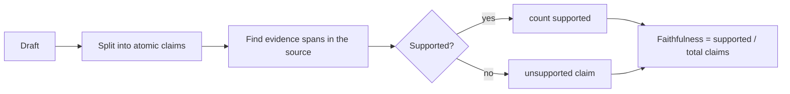

# 12. Drafting and Knowledge-Work Models

**Goal:** train a small assistant for writing tasks (summaries, emails, reports, meeting notes, rewriting, extraction to templates) that is **faithful to its sources**, follows a style, and can be evaluated without pretending that "sounds good" is a metric.
**Builds on:** chapters 3, 4, 6, 14. **Lab:** `labs/08_evaluation_statistics` (judge agreement and CIs).

## 12.1 What makes writing tasks different

Quality is multi-dimensional and partly subjective. Decompose it into **checkable** and **judged** parts:

| Dimension | Checkable by program? | Typical method |
| --- | --- | --- |
| Format (JSON schema, headings, length, bullet count) | yes | validators |
| Required content present | mostly | field/keyword/entity checks, extraction comparison |
| **Faithfulness / groundedness** (no unsupported claims) | partly | claim-level support check (NLI model, LLM judge with evidence, span matching) |
| Numbers, names, dates, quotes correct | yes | string/number matching against source |
| Redaction / privacy compliance | yes | PII detectors, blocklists |
| Tone, style, audience fit | no | rubric + human or calibrated judge |
| Usefulness, clarity | no | human preference / pairwise judge |

A draft that is elegant but invents a deadline **fails**. Put the checkable constraints first, then optimise the judged ones.

## 12.2 The task contract

For every drafting task write: audience; sources allowed; output format; must-include / must-not-include; tone; length; *what to do when evidence is missing* (say "not stated", ask, or omit); how to cite (source ids/quotes). Example (meeting notes): "Use only the provided transcript. Output JSON with `decisions`, `action_items{owner,task,due?}`, `risks`, `open_questions`. If an owner or date is not stated write `null`. Never infer commitments."

## 12.3 Training strategies

1. **Prompt + template first.** Many drafting tasks are solved by a good system prompt, a schema and examples. Measure before training.
2. **SFT on (source, ideal draft) pairs** in the exact contract format. Sources: expert-written drafts, edited model drafts, historical documents *with permission*. Include negative/edge examples: missing information, contradictions, very long inputs.
3. **Style adaptation.** Fine-tune on a person's or organisation's writing only with consent; 200-2000 examples can shift voice with LoRA. Keep a held-out set of *unseen topics* and check the model still respects content constraints (style training can cause hallucinated "in-voice" details).
4. **Preference optimisation (DPO/KTO/SimPO)** for pairs with a clear reason: supported vs invented claim, concise vs padded, correctly redacted vs leaked, on-tone vs off-tone. Human *edits* (final version chosen, original rejected) are the best pairs: they show exactly what to change. Control length (chapter 6.7).
5. **Verifier-filtered rejection sampling:** sample several drafts, keep those that pass all programmatic checks and score high on the rubric.
6. **RL:** possible with programmatic rewards (format + coverage + support); avoid optimising a learned style reward without strong regularisation (over-optimisation makes text bland or exploit the judge).
7. **Retrieval instead of memory** for facts about the user's world (chapter 13).

## 12.4 Faithfulness: a practical claim-level pipeline

Implementations range from exact/fuzzy matching (strict, high precision) to NLI models or LLM judges (more flexible, need calibration). Use the strict one as a **hard gate** in training data filtering and the flexible one for evaluation, and always audit samples by hand.

**Metrics**

* Faithfulness $=\frac{\#\text{supported claims}}{\#\text{claims}}$; also report the rate of drafts with *any* unsupported claim.
* Coverage (recall) $=\frac{\#\text{required items present}}{\#\text{required items}}$.
* Field-level F1 for structured outputs: $F_1=\frac{2PR}{P+R}$.
* Avoid relying on ROUGE/BLEU alone: they reward lexical overlap, not truth; BERTScore-like metrics are better but still not faithfulness.

## 12.5 LLM-as-judge: use with care

A stronger model scores or ranks drafts against a rubric. Known biases: **position bias** (prefers the first/last answer), **verbosity bias**, **self-preference**, sensitivity to formatting, and inconsistency at temperature > 0. Mitigations:

* Pairwise comparisons with **both orders** and require consistency; break ties as "tie".
* Rubric with explicit criteria and scale anchors; ask for evidence quotes before the score.
* **Calibrate against humans:** collect 100-200 human labels and compute agreement. Cohen's kappa
  $$
  \kappa=\frac{p_o-p_e}{1-p_e}
  $$
  ($p_o$ observed agreement, $p_e$ chance agreement from marginals). $\kappa<0.4$ means the judge is not trustworthy for that criterion.
* Keep the judge **different from the model being trained** (no self-grading in reward loops) and do not let the training pipeline see the judge's prompt.
* Report judge model + version + prompt hash.

## 12.6 Structured output and constrained decoding

For JSON/forms use schema-constrained decoding at inference and **schema validation** in training data. Allow an explicit `"not_stated"` or `null` value - otherwise the model is forced to invent. Train abstention explicitly with examples where the answer is absent.

## 12.7 Privacy, consent and IP

Redact PII before training; log only what you must; do not train a shared model on one customer's confidential documents without agreement; keep adapters per tenant; beware that fine-tuned models can regurgitate training text - test with extraction attempts (prefix prompting). Respect copyrights/licenses of source documents.

## 12.8 Step-by-step project: grounded meeting-notes extractor

1. Collect or synthesise 300 transcripts (with permission or fully synthetic) and gold JSON written to the contract. Split by meeting series.
2. Programmatic checks: schema valid; every `owner` appears in the transcript; every `due` date string appears or is `null`; no extra keys.
3. Baselines: prompted base model; prompted stronger teacher.
4. SFT with LoRA (script 01 adapted). Metrics: field F1, schema validity, unsupported-claim rate.
5. Add 200 hard negatives: transcripts lacking owners/dates -> `null`.
6. Build DPO pairs from `invented owner` vs `null`; train with `["sigmoid","sft"]` and small LR; verify the unsupported-claim rate drops without recall loss.
7. Judge/human review of 50 outputs for nuance (omitted decisions, merged items).
8. Regression: general prompts; long transcripts; transcripts in noisy ASR style.

## 12.9 Pros and cons

| Approach | Pros | Cons |
| --- | --- | --- |
| Prompt + schema | fast, no training | fragile with small models |
| SFT | consistent format/voice | can overfit style; needs clean data |
| DPO on edits | targets precise preferences | pair quality; length effects |
| Judge-based evaluation | scales | biased unless calibrated |
| Human evaluation | ground truth | slow/costly; needs guidelines |

## Checkpoint

* Your contract, programmatic checks, and claim-level faithfulness metric exist and were audited on 50 samples.
* Your model abstains correctly when evidence is missing.
* Any judge you use has been calibrated against human labels (kappa reported).
