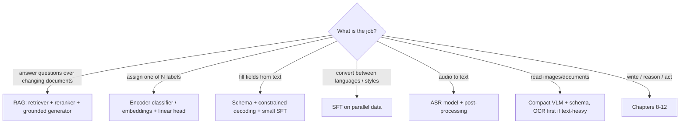

# 13. Other Use Cases: RAG, Embeddings, Classification, Extraction, Translation, Speech, Multimodal

**Goal:** choose the *cheapest model that meets the requirement*. Many useful systems need no generative fine-tuning at all.
**Lab:** `labs/11_reward_model_and_infonce` (contrastive training of a retriever).

## 13.1 Decision map

Always build the **simplest baseline** (rules, keyword search, logistic regression on embeddings) and compare. Use a generative model only when the baseline's errors matter and the model's flexibility pays for its risk and cost.

## 13.2 Retrieval-augmented generation (RAG)

**Why:** facts change, must be cited, or are too numerous to memorise. Fine-tuning teaches *behaviour*; retrieval supplies *knowledge*.

**Pipeline and choices**

1. **Ingest:** parse documents (PDF/HTML/OCR), keep structure and metadata (title, section, date, permissions).
2. **Chunk:** 200-500 tokens with overlap, aligned to headings; store stable ids. Bad chunking is the most common RAG bug.
3. **Index:** dense embeddings (+ sparse BM25). **Hybrid** retrieval (combine scores, e.g. reciprocal rank fusion $\mathrm{RRF}(d)=\sum_r\frac{1}{k+\mathrm{rank}_r(d)}$, $k\approx60$) is usually stronger than either alone.
4. **Rerank:** a cross-encoder scores (query, passage) pairs for the top 50-100 candidates.
5. **Generate:** prompt with top passages and ids; instruct to answer *only* from passages, cite ids, and say "not found" otherwise.
6. **Verify:** citation exists; claim supported (chapter 12.4).

**Metrics (evaluate retrieval separately from generation)**

$$
\text{Recall@}k=\tfrac1N\sum_i\mathbb{1}[\text{gold}_i\in\text{top-}k],\quad \text{MRR}=\tfrac1N\sum_i\tfrac{1}{\text{rank}_i},\quad \text{nDCG@}k=\frac{\mathrm{DCG@}k}{\mathrm{IDCG@}k},\ \mathrm{DCG@}k=\sum_{j=1}^{k}\frac{\text{rel}_j}{\log_2(j+1)}
$$

If Recall@k is low, no generator can fix it. Then measure answer correctness, **faithfulness** and citation accuracy.

**What to fine-tune in RAG (if anything):** the **embedding model** (contrastive loss below) on your (query, positive passage) pairs; the **reranker**; the **generator** for grounded style, abstention and citation formatting (train on examples with *distractor* passages and unanswerable questions).

| Approach | Pros | Cons |
| --- | --- | --- |
| RAG | fresh, attributable, updateable | pipeline complexity; retrieval errors dominate |
| Fine-tune facts | fast at inference | stale, hard to update, hallucination |
| Long context | simple | costly; small models degrade in the middle of long contexts |

## 13.3 Embedding models and the contrastive loss

Learn an encoder $f$ so related texts are close. With a batch of (query $q_i$, positive $d_i^+$) and in-batch negatives, **InfoNCE**:
$$
\mathcal{L}=-\frac{1}{B}\sum_{i}\log\frac{\exp(s(q_i,d_i^+)/\tau)}{\sum_{j}\exp(s(q_i,d_j)/\tau)},\quad s=\cos(f(q),f(d))
$$
Temperature $\tau$ (often 0.02-0.1) controls how sharply hard negatives are emphasised. **Hard negatives** (similar but wrong passages) matter most. Lab 11 trains a tiny retriever and shows Recall@k rising. Larger batches give more negatives; with 12 GB use gradient caching or smaller encoders (100M-600M params).

## 13.4 Classification and routing

| Situation | Use |
| --- | --- |
| Fixed labels, enough data | fine-tune a small encoder (BERT-like), or embeddings + logistic regression |
| Few labels, little data | embeddings + few-shot / SetFit-style contrastive fine-tuning |
| Labels change often / need reasoning | prompted or LoRA-tuned LLM with constrained output |
| Multi-label | sigmoid outputs + per-label thresholds |

Report **macro-F1** (equal weight per class), per-class recall, confusion matrix, and **calibration**: expected calibration error $\mathrm{ECE}=\sum_{b}\frac{|B_b|}{N}\big|\mathrm{acc}(B_b)-\mathrm{conf}(B_b)\big|$. Use thresholds and an **abstain/"other"** class for routing where errors are costly. Class imbalance: weighted loss or resampling, and evaluate with precision-recall curves.

## 13.5 Information extraction

* Define a JSON schema with `null` for missing; validate; **constrained decoding** eliminates syntax errors.
* Train SFT on (text, JSON) with hard cases: missing fields, multiple entities, ambiguous mentions, OCR noise.
* Metrics: **field-level precision/recall/F1**, exact-record match, and **span grounding** (value appears in the text).
* Text-to-SQL and text-to-regex-style tasks are *verifiable* (execute and compare results): excellent candidates for rejection sampling and GRPO (chapters 8, 9).

## 13.6 Translation, rewriting, transliteration

SFT with LoRA on domain parallel data. Metrics: chrF/BLEU (surface), **COMET-style learned metrics**, plus human adequacy/fluency on a sample; check **terminology, numbers and named entities**. For low-resource languages, tokenizer efficiency may dominate quality and cost: compare tokens per sentence across candidate models.

## 13.7 Speech

**ASR** is typically a dedicated encoder-decoder model (Whisper-class); fine-tuning with LoRA on domain audio helps accents/jargon. Metric: word error rate
$$
\mathrm{WER}=\frac{S+D+I}{N}
$$
(substitutions, deletions, insertions over reference words). Pipeline: ASR -> segmentation/diarization -> summarise/extract; evaluate each stage and propagate confidence (low-confidence words should not become confident facts in a summary).

## 13.8 Documents and multimodal understanding

* **Text-heavy documents:** OCR/layout parsing first (keep coordinates), then text LLM; send images to a VLM only for charts, figures, handwriting, complex layouts.
* **VLM fine-tuning on 12 GB:** 2-4B VLM, LoRA on the language model (and optionally projector), cap image resolution, batch 1 with accumulation; TRL supports VLM SFT/DPO/GRPO (use `max_length=None` so image tokens are never truncated).
* **Evaluation:** include *text-only controls* (does the model answer without the image?) and *distractor/blank-image* tests to detect language-prior answers.

## 13.9 Pros and cons summary

| Task | First choice | Why | Watch out |
| --- | --- | --- | --- |
| QA over docs | RAG | provenance; updateable | retrieval recall, chunking |
| Intent / routing | encoder classifier | cheap, calibrated, fast | distribution shift, new labels |
| Field extraction | schema + small LLM | verifiable, constrained | ambiguity, abstention |
| Text-to-SQL | SFT + execution verifier | exact verification | schema linking, security (read-only!) |
| Translation | SFT on domain pairs | direct objective | terminology, numbers |
| Speech | ASR model + post-process | specialised | errors propagate |
| Documents | OCR + text LLM, VLM for visuals | cost | layout loss |

## Checkpoint

* You can compute Recall@k, MRR, nDCG, macro-F1, ECE and WER by hand.
* You built one non-generative baseline for your task and know its score.
* You can state for your use case whether RAG, fine-tuning, or both is the right tool and why.
