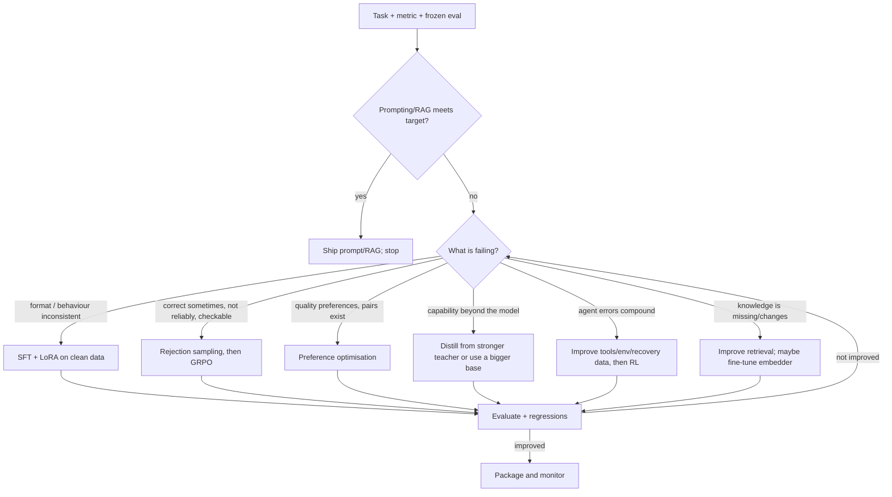

# 16. Capstone, Decision Guide and Reading List

## 16.1 Decision guide: what to do next

| Observation | Next move |
| --- | --- |
| pass@8 high, pass@1 low | rejection sampling -> GRPO (sharpening) |
| pass@8 ~ 0 | SFT/distillation first; RL has no signal |
| Good train, bad dev | leakage/overfit: dedupe, group split, fewer epochs, more diverse data |
| Format errors | constrained decoding, more format SFT, schema validation |
| Hallucinated details | abstention data, DPO on invented vs null, retrieval, stricter verifiers |
| Reward rises, true metric falls | reward hacking: inspect top-reward samples, harden the verifier, lower LR |
| Model forgets general skills | lower LR, LoRA, replay data, regression suite |
| Agent succeeds step-wise, fails tasks | closed-loop data, recovery demos, shorten horizon, RL in sandbox |

## 16.2 Capstone projects (choose one; do it end to end)

Each capstone needs: task contract; frozen eval; baselines; SFT adapter; at least one verifier-based improvement (rejection sampling, DPO, or GRPO); ablation of one design choice; failure analysis of 20 samples; safety notes; model card; reproducible scripts.

| Project | Verifier | Methods | Stretch |
| --- | --- | --- | --- |
| **A. Read-only SQL analyst agent** | result equality on held-out schemas | SFT trajectories -> RFT -> GRPO | prompt-injection robustness |
| **B. Local web-form GUI agent** (DOM first, then screenshots) | app state check | trajectory SFT -> RFT -> grounding reward | perturbation robustness, VLM version |
| **C. Bug-fix coder** (mutation-generated tasks) | hidden unit tests in sandbox | SFT -> RFT -> GRPO | FIM + patch formats |
| **D. Grounded meeting-notes extractor** | schema + claim-support checks | SFT -> DPO (invented vs null) | judge calibration |
| **E. Small math/logic reasoner** | answer match | distillation/RFT -> GRPO | length control |
| **F. RAG assistant for a document set** | retrieval recall + faithfulness | embedder fine-tune + grounded-generation SFT | abstention |

### Acceptance criteria (example for project C)
* Baseline pass@1 (n=8) and pass@8 recorded with CIs.
* Fine-tuned model improves pass@1 by >= 10 points with paired CI excluding 0 on held-out repositories.
* Patch apply rate >= 95%; hidden-test pass rate reported; 0 sandbox escapes in tests.
* 20 failures categorised; reward-hack tests documented.
* Model card + run log + pinned environment.

## 16.3 A twelve-session study plan

| Session | Do | Output |
| --- | --- | --- |
| 1 | Chapters 1-2; labs 00, 01; `scripts/00_xpu_check` | working XPU env, measured numbers |
| 2 | Chapter 3; build a dataset + split + masks check | data card |
| 3 | Chapter 4; lab 03; script 01 | first LoRA adapter |
| 4 | Chapter 14; lab 08; script 04 | base-vs-adapter table with CIs |
| 5 | Chapter 5; lab 07 | distillation plan |
| 6 | Chapter 6; labs 04, 11; script 02 | DPO pairs + run |
| 7 | Chapter 7; lab 06; lab 05 | RFT vs GRPO comparison on toy task |
| 8 | Chapter 8; your verifier + baseline table | reasoning baseline |
| 9 | Chapter 9 or 10; lab 09 | sandbox environment + expert demos |
| 10 | Script 03 (GRPO smoke test on real model) | first RL curves |
| 11 | Chapters 11-13 as relevant | domain-specific extension |
| 12 | Chapter 15; model card; capstone report | shipped artifact |

## 16.4 Reading list

**Status key:** `[V]` identifier/content confirmed while writing this edition via the page or docs indicated; `[T]` cited from memory by title/authors/year - look it up and confirm before relying on details (arXiv and Semantic Scholar APIs were rate-limiting at the time, so I could not machine-verify every ID).

### Foundations
* `[T]` Vaswani et al., *Attention Is All You Need* (2017).
* `[T]` Su et al., *RoFormer: Enhanced Transformer with Rotary Position Embedding* (2021).
* `[T]` Ainslie et al., *GQA: Training Generalized Multi-Query Transformer Models from Multi-Head Checkpoints* (2023).
* `[T]` Loshchilov & Hutter, *Decoupled Weight Decay Regularization* (AdamW, 2019).
* `[T]` Kaplan et al., *Scaling Laws for Neural Language Models* (2020); Hoffmann et al., *Training Compute-Optimal Large Language Models* (Chinchilla, 2022).
* `[T]` Zhou et al., *LIMA: Less Is More for Alignment* (2023).

### Fine-tuning and PEFT
* `[V]` Hu et al., *LoRA: Low-Rank Adaptation of Large Language Models*, arXiv:2106.09685.
* `[V]` Schulman & Thinking Machines, *LoRA Without Regret* (Sep 2025), https://thinkingmachines.ai/blog/lora/ - read in full: all-layers LoRA, LR ~10x, RL needs tiny capacity.
* `[T]` Dettmers et al., *QLoRA: Efficient Finetuning of Quantized LLMs* (2023).
* `[T]` Liu et al., *DoRA* (2024); Hayou et al., *LoRA+* (2024); Kalajdzievski, *rsLoRA* (2023); Meng et al., *PiSSA* (2024); Li et al., *LoftQ* (2023; referenced in the PEFT docs).
* `[V]` Hugging Face PEFT LoRA guide: https://huggingface.co/docs/peft/main/en/conceptual_guides/lora

### Preference optimisation
* `[T]` Ouyang et al., *Training language models to follow instructions with human feedback* (InstructGPT, 2022); Christiano et al. (2017); Stiennon et al. (2020).
* `[V]` Rafailov et al., *Direct Preference Optimization*, arXiv:2305.18290.
* `[V]` Azar et al., *A General Theoretical Paradigm to Understand Learning from Human Preferences* (IPO), arXiv:2310.12036.
* `[V]` Meng et al., *SimPO*, arXiv:2405.14734.
* `[T]` Ethayarajh et al., *KTO* (2024); Hong et al., *ORPO* (2024).
* `[V]` TRL DPO docs (loss types, metrics): https://huggingface.co/docs/trl/main/en/dpo_trainer

### Reinforcement learning for LLMs
* `[T]` Schulman et al., *Proximal Policy Optimization Algorithms* (2017); *High-Dimensional Continuous Control Using GAE* (2015).
* `[T]` Ahmadian et al., *Back to Basics: Revisiting REINFORCE-Style Optimization...* (RLOO, 2024).
* `[V]` Shao et al., *DeepSeekMath* (introduces GRPO), arXiv:2402.03300.
* `[V]` DeepSeek-AI, *DeepSeek-R1: Incentivizing Reasoning Capability in LLMs via Reinforcement Learning*, arXiv:2501.12948.
* `[V]` Liu et al., *Understanding R1-Zero-Like Training: A Critical Perspective* (Dr. GRPO), arXiv:2503.20783.
* `[V]` Yu et al., *DAPO*, arXiv:2503.14476.
* `[V]` Zheng et al., *Group Sequence Policy Optimization* (GSPO), arXiv:2507.18071.
* `[V]` *Tricks or Traps? A Deep Dive into RL for LLM Reasoning (Lite PPO)*, arXiv:2508.08221; Skywork-OR1, arXiv:2505.22312; ScaleRL, arXiv:2510.13786; *Beyond the 80/20 Rule*, arXiv:2506.01939.
* `[V]` Lambert et al., *Tulu 3* (RLVR), arXiv:2411.15124.
* `[V]` TRL GRPO docs (loss types, defaults, agent training): https://huggingface.co/docs/trl/main/en/grpo_trainer
* `[T]` Yue et al. (2025), *Does Reinforcement Learning Really Incentivize Reasoning Capacity in LLMs Beyond the Base Model?*

### Reasoning
* `[T]` Wei et al. (2022) *Chain-of-Thought Prompting*; Wang et al. (2022) *Self-Consistency*; Zelikman et al. (2022) *STaR*; Lightman et al. (2023) *Let's Verify Step by Step*; Snell et al. (2024) *Scaling LLM Test-Time Compute Optimally...*; Muennighoff et al. (2025) *s1: Simple test-time scaling*.
* `[V]` Hugging Face blog *Open-R1: a fully open reproduction of DeepSeek-R1* (Jan 2025; listed on the TRL docs page).

### Distillation
* `[T]` Hinton et al., *Distilling the Knowledge in a Neural Network* (2015); Kim & Rush (2016) *Sequence-Level Knowledge Distillation*; Gu et al., *MiniLLM* (2023); Agarwal et al., *On-Policy Distillation of Language Models (GKD)* (2023).
* `[V]` Thinking Machines *On-Policy Distillation* post (linked from their blog; content not reviewed while writing).

### Agents, tools, GUI
* `[T]` Yao et al., *ReAct* (2022); Schick et al., *Toolformer* (2023); Yao et al., *tau-bench* (2024); Zhou et al., *WebArena* (2023).
* `[T]` Deng et al., *Mind2Web* (2023); Rawles et al., *AndroidWorld* (2024); Xie et al., *OSWorld* (2024).
* `[T]` Cheng et al., *SeeClick* (2024); Wu et al., *OS-Atlas* (2024); Lin et al., *ShowUI* (2024); Xu et al., *Aguvis* (2024); Qin et al., *UI-TARS* (2025).

### Code
* `[T]` Chen et al., *Evaluating Large Language Models Trained on Code* (Codex/HumanEval, pass@k, 2021); Jimenez et al., *SWE-bench* (2023); Yang et al., *SWE-agent* (2024); Jain et al., *LiveCodeBench* (2024); Wei et al., *Magicoder* (2023).

### Systems
* `[V]` PyTorch docs, *Getting Started on Intel GPU* (2.14): https://docs.pytorch.org/docs/2.14/notes/get_start_xpu.html
* `[V]` Intel, *PyTorch Prerequisites for Intel GPUs* (driver install incl. WSL2): https://www.intel.com/content/www/us/en/developer/articles/tool/pytorch-prerequisites-for-intel-gpu.html
* `[V]` IPEX archive/retirement notice: https://github.com/intel/intel-extension-for-pytorch
* `[V]` bitsandbytes installation guide (Intel XPU backend): https://huggingface.co/docs/bitsandbytes/main/en/installation
* `[V]` TRL docs index (trainer taxonomy): https://huggingface.co/docs/trl/main/en/index
* `[T]` Frantar et al., *GPTQ* (2022); Lin et al., *AWQ* (2023); Leviathan et al., *Fast Inference from Transformers via Speculative Decoding* (2022); Kwon et al., *PagedAttention/vLLM* (2023).

### Books and courses
* Sutton & Barto, *Reinforcement Learning: An Introduction* (2nd ed., free online) - chapters on policy gradient.
* Hugging Face *smol course* (post-training with TRL), linked from the TRL docs.
* Karpathy's "Let's build GPT" video series.

## 16.5 Glossary

**Advantage** - how much better an action/sample is than a baseline. **Base model** - pretrained only. **Instruct model** - also post-trained to follow instructions. **Chat template** - formatting rules for messages. **CPT** - continued pretraining. **DPO** - direct preference optimisation. **GQA** - grouped-query attention. **GRPO** - group relative policy optimisation. **KL divergence** - asymmetric distance between distributions. **KV cache** - stored keys/values for past tokens. **LoRA** - low-rank adapters. **MFU** - model FLOPs utilisation. **NF4** - 4-bit normal-quantile format. **On-policy** - data sampled from the model being trained. **pass@k** - probability at least one of $k$ samples is correct. **Perplexity** - $e^{\text{loss}}$. **PEFT** - parameter-efficient fine-tuning. **Policy** - the model as a distribution over actions/tokens. **Reference model** - frozen model used to limit drift. **Reward hacking** - high reward without the intended outcome. **RLVR** - RL with verifiable rewards. **RoPE** - rotary position embedding. **SFT** - supervised fine-tuning. **Verifier** - program that judges correctness.

## 16.6 Final standard

You "own" a model when you can: state its task boundary; reproduce the training from versioned data and config; show a held-out improvement over baselines with confidence intervals; explain its failure modes; run it within the safety limits you defined; and ship and roll back a versioned artifact.
