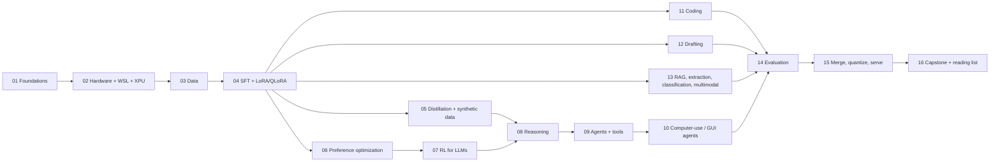

# Training Small Language Models on One Intel Arc B580 (12 GB) - WSL2 Ubuntu 24.04

A step-by-step course that takes you from *how a transformer computes* to *training, evaluating and shipping your own small specialist models* with traditional methods (pretraining, SFT, LoRA/QLoRA, distillation) and modern RL methods (preference optimization, rejection sampling, GRPO-family RL with verifiable rewards). Use cases covered: **reasoning**, **tool-using agents**, **computer-use (GUI) agents**, **coding**, **drafting/knowledge work**, and **RAG / extraction / classification / multimodal**.

> **Version note.** This is the second edition. The first edition (kept in `archive/v1/`) was a shallow outline and recommended Intel Extension for PyTorch (IPEX), which Intel **archived on 30 Mar 2026**. Everything here uses upstream PyTorch XPU.

## How to use this course

1. Read a chapter (concept -> math -> procedure -> pros/cons).
2. Open its lab (`labs/*.ipynb`) or script (`scripts/*.ipynb`) and run it cell by cell. Every `.py` file is also a notebook source: `# %%` marks cells. Regenerate notebooks with `python tools/py_to_ipynb.py labs scripts` after editing a `.py`.
3. Do the exercises at the end of each lab. They are where the understanding happens.
4. Write down your results in an experiment log (template in chapter 14).

### Two kinds of code - know which is which

| Folder | What it is | Needs GPU? | Verified? |
| --- | --- | --- | --- |
| `labs/` | From-scratch PyTorch/stdlib code on a tiny model and toy tasks. Teaches the *mechanics* (attention, LoRA, DPO, GRPO, evaluation statistics...). | No (CPU is fine, seconds-minutes) | Written for learning; **not yet executed in this edition** - you will run and check them as you study. |
| `scripts/` | Real-model recipes with Hugging Face TRL + PEFT aimed at the B580 (SFT, DPO, GRPO, eval, merge). | Yes (XPU) | Written against the current TRL docs; **not yet run on your hardware**. Treat every number as a starting point. |

## The route

| # | Chapter | Main ideas | Lab / script |
| --- | --- | --- | --- |
| 01 | [Foundations and math](01-foundations-transformer-math.md) | tokens, LM loss, attention, RoPE, GQA, AdamW, scaling laws, decoding | lab 00, 02 |
| 02 | [Hardware, WSL2 and XPU](02-hardware-wsl-xpu-setup.md) | memory/FLOP math, install, what fits in 12 GB | lab 01, script 00 |
| 03 | [Data, tokenization, templates](03-data-and-tokenization.md) | quality, masking, packing, dedup, splits, synthetic data | - |
| 04 | [SFT, LoRA, QLoRA](04-sft-and-peft.md) | SFT math, low-rank adapters, variants, hyperparameters | lab 03, script 01 |
| 05 | [Distillation](05-distillation-and-synthetic-data.md) | forward vs reverse KL, on-policy distillation | lab 07 |
| 06 | [Preference optimization](06-preference-optimization.md) | Bradley-Terry, RLHF, DPO derivation, IPO/KTO/ORPO/SimPO | lab 04, 11, script 02 |
| 07 | [RL for LLMs](07-rl-for-llms.md) | policy gradient, PPO, RLOO, GRPO, DAPO, Dr. GRPO, GSPO | lab 06, script 03 |
| 08 | [Reasoning models](08-reasoning-models.md) | CoT, STaR/RFT, R1 recipe, test-time compute | lab 05 |
| 09 | [Agents and tool use](09-agents-and-tool-use.md) | function calling, ReAct, multi-turn RL, safety | lab 09 |
| 10 | [Computer-use / GUI agents](10-computer-use-gui-agents.md) | grounding, action spaces, datasets, models, training recipe | lab 09 |
| 11 | [Coding models](11-coding-models.md) | FIM, execution rewards, pass@k, SWE-style tasks | lab 10 |
| 12 | [Drafting and knowledge work](12-drafting-and-writing.md) | rubrics, groundedness, judges, style | - |
| 13 | [RAG, extraction, classification, multimodal](13-other-use-cases.md) | InfoNCE, constrained decoding, VLMs | lab 11 |
| 14 | [Evaluation](14-evaluation.md) | CIs, paired tests, contamination, judges | lab 08, script 04 |
| 15 | [Merge, quantize, serve](15-deployment-merging-and-serving.md) | merging, GGUF/AWQ/GPTQ, serving | script 05 |
| 16 | [Capstone and reading list](16-capstone-and-reading.md) | projects, decision tree, papers | - |

## Which path for which goal?

| You want... | Do chapters | First project |
| --- | --- | --- |
| A reliable structured-output/extraction model | 01-04, 14 | JSON extractor with LoRA (script 01, 04) |
| A small reasoning model | 01-08, 14 | verifier + rejection sampling -> GRPO on arithmetic/SQL |
| A tool-using agent | 01-04, 08, 09, 14 | SQL/calculator agent with a sandbox |
| A desktop/mobile/browser agent | 01-04, 07, 09, 10, 14 | local web-form agent: DOM first, screenshots later |
| A coding assistant | 01-04, 07, 11, 14 | issue-to-patch on tiny repos with hidden tests |
| A drafting / knowledge-work assistant | 01-04, 06, 12, 14 | grounded meeting-notes summariser |

## What fits on a B580 (12 GB) - the one-page answer

| Activity | Practical model size | Comment |
| --- | --- | --- |
| Inference, 4-bit | up to roughly 8B-14B | leave room for KV cache; speed bounded by memory bandwidth |
| LoRA/QLoRA SFT | ~0.5B-4B comfortable, 7-8B only with QLoRA + short context | activations and logits decide, not weights |
| DPO (LoRA) | 0.5B-3B | policy + reference (adapter disabled) + long pairs |
| GRPO/RL | 0.5B-1.7B realistic; 3-4B possible with short completions | generation dominates; group size multiplies KV cache |
| Full fine-tuning | <=0.5B | about 16 bytes/parameter with mixed-precision AdamW |
| VLM GUI agents | 2B-4B VLM with LoRA, low image resolution | image tokens consume context and activations |

Models named in current TRL documentation as tested examples: `Qwen/Qwen3-0.6B`, `Qwen/Qwen3-VL-2B-Instruct`, `Qwen/Qwen3.5-2B`, `HuggingFaceTB/SmolLM3-3B`, `meta-llama/Llama-3.2-3B-Instruct`, `google/gemma-3-4b-it`, `HuggingFaceTB/SmolVLM2-2.2B-Instruct`, `Qwen/Qwen2.5-VL-3B-Instruct`. New releases appear constantly: **always check the Hub for newer small models, their licenses, and their chat templates** before you start.

## Conventions

* $\theta$ parameters, $\pi_\theta$ a policy (the LLM), $x$ prompt, $y$ completion, $r$ reward, $\sigma$ sigmoid, $\beta$ KL strength.
* "nats" = loss units when using natural log. Perplexity $=e^{\text{loss}}$.
* **Pros/cons** tables appear wherever a method choice exists. **Checkpoint** boxes tell you when you are ready to move on.
* Citations: primary sources are listed in chapter 16. Identifiers I could verify while writing are linked; others are cited by title/authors/year so you can look them up, and are marked accordingly. Do not trust any single number from a blog or paper without reproducing it on your task.

## Non-negotiable habits

1. One task, one metric, frozen held-out set **before** training.
2. Base-model and prompting baselines first.
3. One change at a time; record versions, seeds, decoding settings.
4. Read 20 raw failures before changing anything.
5. Sandboxes and confirmation gates for every action an agent can take.
6. Respect licenses, privacy and terms of service for every model and dataset you touch.
