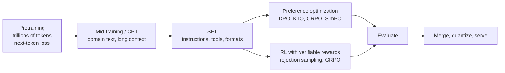

# 1. Foundations and Mathematics of Language Models

**Goal:** understand exactly what a decoder-only LLM computes and how it is trained, so every later method (SFT, DPO, GRPO...) is a small modification of something you already understand.
**Labs:** `labs/00_attention_rope_gqa`, `labs/02_pretrain_tiny_gpt`.

## 1.1 The pipeline

You will almost never run the first box. You start from a public **base** or **instruct** model and run the later boxes. Understanding the first box tells you what the model already knows and what post-training can and cannot add.

## 1.2 Tokens

Text is split into *tokens* (sub-word units) by a tokenizer, most commonly **byte-pair encoding (BPE)**: start from bytes/characters and repeatedly merge the most frequent adjacent pair until the vocabulary has $V$ entries (typically 32k-256k).

* A token is not a word: "unbelievable" may be 3 tokens; numbers often split into digit groups; code and non-English text are usually less efficient (more tokens per character). Token counts determine **cost** (memory, time) and **context usage**.
* The embedding table and (often tied) output head each have $V\cdot d$ parameters. For $V=150\text{k}$, $d=1024$ that is 154M parameters - a quarter of a 0.6B model! Small models are *embedding-heavy*.
* **Special tokens** (`<|im_start|>`, `<|im_end|>`, BOS/EOS, tool-call markers) delimit chat turns. The **chat template** turns a list of messages into token ids. Training with a different template than inference is a classic silent bug (chapter 3).

## 1.3 The language-modelling objective

A sequence $x_{1:T}$ is modelled autoregressively:

$$p_\theta(x_{1:T})=\prod_{t=1}^{T}p_\theta(x_t\mid x_{<t})$$

Training minimises the average negative log-likelihood (cross-entropy):

$$\mathcal{L}(\theta)=-\frac{1}{T}\sum_{t=1}^{T}\log p_\theta(x_t\mid x_{<t})$$

* Units: nats per token. **Perplexity** $=e^{\mathcal{L}}$ is the effective number of equally-likely choices per token.
* Comparing losses across models is only valid with the **same tokenizer and data**; use bits-per-byte to compare across tokenizers: $\text{bpb}=\mathcal{L}\cdot\frac{\#\text{tokens}}{\#\text{bytes}\cdot\ln 2}$.
* Low loss $\ne$ good behaviour when *sampled*. Lab 02 shows a model with excellent held-out loss but only ~50% correct sampled answers because the training data contained 50% wrong answers.

## 1.4 The transformer block

Notation: $d$ model width, $h$ query heads, $g$ key/value heads, $d_h=d/h$ head width, $L$ layers, $s$ sequence length.

**Attention (one head).** With $Q=XW_Q,\ K=XW_K,\ V=XW_V$:

$$\mathrm{Attn}(Q,K,V)=\mathrm{softmax}\!\left(\frac{QK^\top}{\sqrt{d_h}}+M\right)V$$

$M_{ij}=-\infty$ for $j>i$ enforces causality. The $1/\sqrt{d_h}$ keeps score variance at 1 (lab 00 demonstrates this numerically). Multi-head attention runs $h$ heads in parallel and concatenates them through $W_O$.

**Position information: RoPE.** Each pair of channels is rotated by an angle proportional to position $m$: $\theta_i=B^{-2i/d_h}$ with base $B$ (often 10,000; larger for long context). Because rotations compose, $\langle R_mq,R_nk\rangle$ depends only on $m-n$: attention becomes *relative*, and extrapolating to longer context amounts to changing $B$ or interpolating positions (lab 00).

**Grouped-query attention (GQA).** $g<h$ KV heads, shared across $h/g$ query heads. Parameters in $W_K,W_V$ and the **KV cache** shrink by $h/g$:

$$\text{KV bytes}=2\cdot L\cdot g\cdot d_h\cdot s\cdot b\cdot \text{bytes}$$

($b$ = concurrent sequences). On a 12 GB GPU, KV cache is often the limit for long context and for RL groups.

**MLP and norms.** Modern blocks use pre-norm **RMSNorm** ($y=x/\sqrt{\tfrac1d\sum x_i^2+\epsilon}\odot\gamma$) and a **SwiGLU** MLP: $y=W_d(\mathrm{SiLU}(W_gx)\odot W_ux)$ with intermediate width $d_{ff}\approx\tfrac83d$ so it has the same cost as a 4x MLP. Residual connections add each sublayer's output to the stream:

$$x\leftarrow x+\mathrm{Attn}(\mathrm{Norm}(x)),\qquad x\leftarrow x+\mathrm{MLP}(\mathrm{Norm}(x))$$

**Mixture of experts (MoE).** Replace the MLP by $E$ experts and route each token to the top-$k$. Total parameters grow by $E$, **active** parameters per token only by $k$. Memory must hold *all* experts, so MoE models are usually a poor fit for 12 GB unless heavily quantised.

**Parameter count** (dense, GQA, SwiGLU, tied embeddings):

$$N\approx Vd+L\Big[\underbrace{d(hd_h)+2d(gd_h)+(hd_h)d}_{\text{attention}}+\underbrace{3\,d\,d_{ff}}_{\text{MLP}}\Big]$$

Lab 01 implements this and checks it against published sizes.

**Compute.** Forward FLOPs per token $\approx 2N$ (+ an attention term growing linearly with $s$). Training (forward+backward) $\approx 6N$ per token, so total training FLOPs $\approx 6ND$ for $D$ tokens.

## 1.5 Optimization

**AdamW** keeps, per parameter, a first moment $m$ and second moment $v$ of the gradient $g_t$:

$$m_t=\beta_1m_{t-1}+(1-\beta_1)g_t,\quad v_t=\beta_2v_{t-1}+(1-\beta_2)g_t^2,\quad \theta_t=\theta_{t-1}-\eta\Big(\tfrac{\hat m_t}{\sqrt{\hat v_t}+\epsilon}+\lambda\theta_{t-1}\Big)$$

with bias-corrected $\hat m,\hat v$. Weight decay $\lambda$ is *decoupled* (Loshchilov & Hutter, 2019). Typical LLM settings: $\beta_1=0.9,\ \beta_2=0.95$-$0.999,\ \lambda=0$-$0.1$.

* **Memory:** $m$ and $v$ cost 8 extra bytes per parameter in fp32 - this is why full fine-tuning needs ~16 bytes/parameter and why LoRA (optimizer state only for adapters) is the default on small GPUs.
* **Learning-rate schedule:** linear warmup (stabilises early steps) then cosine or linear decay (or warmup-stable-decay). Learning rate is the single most important hyperparameter; chapter 4 gives the LoRA-specific rule.
* **Gradient clipping** (global norm 1.0) guards against loss spikes.
* **Effective batch** $=\text{micro-batch}\times\text{gradient accumulation}\times\#\text{devices}$. Accumulation trades time for memory with the same gradient (up to normalisation details across padded batches).
* **Mixed precision:** compute in bf16 (8-bit exponent, same range as fp32, fewer mantissa bits) or fp16 (needs loss scaling because of its small range). Keep optimizer state and master weights in fp32 unless you know the trade-off. The Arc B-series supports bf16/fp16/AMP in PyTorch XPU.
* **Gradient checkpointing:** do not store activations; recompute them in the backward pass. Roughly +30% time for a large cut in activation memory.

## 1.6 Scaling laws and why small models work

Empirically, loss follows a power law in parameters $N$ and data $D$ (Kaplan et al. 2020; Hoffmann et al. 2022, "Chinchilla"):

$$L(N,D)\approx E+\frac{A}{N^{\alpha}}+\frac{B}{D^{\beta}}$$

For a fixed compute budget $C\approx6ND$, Chinchilla found the optimum near **$D\approx20N$ tokens**. But *deployed* small models are trained far beyond that (trillions of tokens for single-digit-billion parameters) because inference cost scales with $N$, not $D$: you pay for extra training once and save on every query. Consequences for you:

* A well-made 1-4B model can be surprisingly capable: it inherits enormous data exposure, often curated and **distilled from larger teachers**.
* Capacity limits remain: knowledge/facts per parameter are bounded (estimates around 2 bits per parameter for memorised facts are reported in the literature), long multi-step planning degrades first, and small models are more sensitive to quantisation and prompt format.
* **Post-training is where a small model becomes useful for *your* task**: narrow behaviour, format and tool use need far fewer bits than world knowledge, so LoRA-scale updates suffice (chapter 4).

## 1.7 Decoding

Given logits $z$, temperature $T$ gives $p_i=\mathrm{softmax}(z_i/T)$. $T\to0$ is greedy; $T=1$ samples the model's own distribution.

| Method | Idea | Use |
| --- | --- | --- |
| Greedy | argmax | deterministic evaluation of format/extraction |
| Temperature | rescale logits | diversity vs reliability |
| Top-$k$ / top-$p$ | truncate the tail | avoids improbable tokens |
| min-$p$ | keep tokens $\ge p_{\min}\cdot p_{\max}$ | adaptive truncation |
| Beam search | keep best $b$ prefixes | translation; rarely for chat |

Always fix and **report** decoding settings with any result. RL needs $T\approx1$ sampling because it learns from the diversity of the model's own distribution (chapter 7).

## 1.8 Pros and cons of the architecture choices you will meet

| Choice | Pros | Cons |
| --- | --- | --- |
| Decoder-only | one model for everything; simple training | no bidirectional context; encoder models are cheaper for classification/embeddings |
| GQA | much smaller KV cache, faster decoding | small quality loss vs full MHA |
| RoPE | relative positions; long-context tricks available | extrapolation needs care (base/scaling) |
| MoE | capacity at fixed active compute | all weights must fit in memory; routing instability; LoRA on MoE is non-trivial |
| Tied embeddings | saves $Vd$ parameters | slightly constrains output head |

## Checkpoint

You are ready to continue when you can:
1. Write the cross-entropy loss and explain why sampling a low-loss model can still be wrong (lab 02).
2. Compute $N$ and the KV cache for a model config from its `config.json`.
3. Explain why AdamW needs ~16 bytes/parameter in mixed precision and what LoRA changes.
4. State the Chinchilla rule and why deployed small models violate it on purpose.

## Sources to read

Vaswani et al. 2017 (*Attention Is All You Need*); Su et al. 2021 (*RoFormer*, RoPE); Ainslie et al. 2023 (*GQA*); Zhang & Sennrich 2019 (*RMSNorm*); Shazeer 2020 (*GLU Variants Improve Transformer*); Loshchilov & Hutter 2019 (*AdamW*); Kaplan et al. 2020 (*Scaling Laws for Neural Language Models*); Hoffmann et al. 2022 (*Training Compute-Optimal LLMs*). Andrej Karpathy's "Let's build GPT" is the best video companion to lab 02. (Cited by title/authors/year; look them up to confirm details.)
